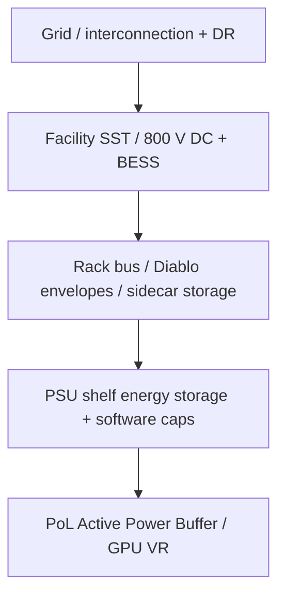

## At a glance

[PoL](https://en.wikipedia.org/wiki/DC-to-DC_converter "Point of load: the final DC-DC converter stage placed right next to the GPU or CPU, turning a board bus such as 12 V into the roughly 1 V core rail.") active buffering, **[800 VDC](https://www.nvidia.com/en-us/data-center/technologies/800-vdc-architecture/ "Distributing power to AI racks at 800 V direct current instead of 54 V DC in-rack or 415/480 V AC, which cuts current and copper for 100 kW to 1 MW racks.")** facility/rack stacks, and grid [demand-response](https://en.wikipedia.org/wiki/Demand_response "Demand response, DR: a large customer cuts or shifts consumption when the grid is stressed, in exchange for payment or faster interconnection, as an alternative to building new supply."). Name the electrical boundary before importing densification claims. Target mix **~50% industry / 30% academia / 20% adjacent**; seed papers ([POLCA](https://arxiv.org/abs/2308.12908 "POLCA: Power Oversubscription in LLM Cloud Providers, Patel et al., Microsoft, ASPLOS 2024; characterizes LLM power headroom and an oversubscription and capping framework."), [TAPAS](https://arxiv.org/abs/2501.02600 "TAPAS: Thermal- and Power-Aware Scheduling for LLM Inference in Cloud Platforms, Stojkovic et al., Microsoft and UIUC."), [DynamoLLM](https://arxiv.org/abs/2408.00741 "DynamoLLM: Designing LLM Inference Clusters for Performance and Energy Efficiency, Stojkovic et al., HPCA 2025; reconfigures serving for energy under SLOs."), PIP, [Prometheus](https://engineering.fb.com/2026/10/19/data-center-engineering/inside-prometheus-meta-gigawatt-scale-supercluster/ "Meta's gigawatt-scale AI supercluster, described by Meta Engineering in Oct 2026, provisioned below TDP with hierarchy-aware capping.")) are excluded from this shortlist.

{: w="1280" h="820" }
_Figure 1. Challenges differ by scale — server, rack, enterprise room, hyperscale DC, and grid._

## Reference: challenges by scale

| Scale | Dominant power problems | Anchor sources |
| --- | --- | --- |
| Server / PoL | Sub-ms–ms GPU spikes (~1.75× rated); [VR](https://en.wikipedia.org/wiki/Voltage_regulator_module "Voltage regulator, or VRM: the multiphase converter that feeds the processor core rail and must hold voltage through fast current steps.")/[PDN](https://en.wikipedia.org/wiki/Power_integrity "Power delivery network: the board and package path of planes, capacitors and regulators from supply to die; its impedance sets how far voltage droops on a load step.") [UVP](https://en.wikipedia.org/wiki/Undervoltage "Under-voltage protection: a converter shutdown that trips when output voltage sags below a threshold, for example during a large GPU load step."); passive 12 V bulk stores little energy → active floating $$C_{\mathrm{bulk}}$$ | Gu [APEC](https://apec-conf.org/ "IEEE Applied Power Electronics Conference, the main venue for practical power-electronics research.") 2026; WeChat [APB](https://doi.org/10.1109/apec51134.2026.11516732 "Gu et al., NVIDIA, IEEE APEC 2026: a board-level active converter plus floating bulk capacitor that absorbs GPU transient energy near the load so upstream stages see smoother current.") summary |
| Rack / [PDU](https://en.wikipedia.org/wiki/Power_distribution_unit "Power distribution unit: the rack- or row-level device that splits and protects feeder power to racks or shelves.") | 100s kW→MW ambitions; copper at low V; stranded nameplate vs feeder; [DC trip](https://en.wikipedia.org/wiki/Circuit_breaker "The current-versus-time characteristic at which a breaker or fuse opens; it bounds how much short overload a feeder tolerates before tripping.")/coordination & capacitive discharge | [NVIDIA](https://www.nvidia.com/en-us/ "US maker of GPUs, AI rack systems, networking and the software stack used in most AI data centers.") 800 VDC; [Eaton](https://en.wikipedia.org/wiki/Eaton_Corporation "Power-management company supplying switchgear, UPS, circuit breakers, solid-state transformers and supercapacitors for data centers.") WP; [Vertiv](https://www.vertiv.com/en-us/ "US maker of data-center power equipment such as UPS, switchgear and busway, and of thermal-management systems."); [Uptime](https://uptimeinstitute.com/ "Uptime Institute: data-center standards and research body known for its Tier classification and annual industry surveys.") 2026 |
| Enterprise / university room | Building feeder, [UPS](https://en.wikipedia.org/wiki/Uninterruptible_power_supply "Uninterruptible power supply: batteries plus converters that keep IT running through outages; some now offer power-smoothing modes.") runtime, floor load, air/liquid lag GPU [TDP](https://en.wikipedia.org/wiki/Thermal_design_power "Thermal design power: the sustained power a chip or PSU is rated to dissipate; GPU power floors and caps are expressed as a percent of TDP."); retrofit MEP cost; cooling–power coupling | [CASC](https://casc.org/ "Coalition for Academic Scientific Computation: a US association of university and research computing centers.") 2024 AI research DC guide |
| Hyperscale DC | MW–GW hierarchical budgets; [PUE](https://en.wikipedia.org/wiki/Power_usage_effectiveness "Power usage effectiveness: total facility power divided by IT power; 1.0 is ideal. IT-side energy burned for smoothing does not show up in PUE.") vs IT; multi-level caps; synchronized training swings | Choukse 2508.14318; [GB300](https://www.nvidia.com/en-us/data-center/gb300-nvl72/ "NVIDIA's Blackwell Ultra rack system with 72 GPUs and 36 Grace CPUs in one NVLink domain; it adds energy-storage PSUs and power-smoothing controls."); [nvPAX](https://arxiv.org/abs/2605.01837 "A constrained-optimization power allocator, arXiv:2605.01837, that sets per-device power budgets on a hierarchical, multi-tenant power tree with a three-phase QP/LP solve each control step; about 265 ms per allocation in the paper's simulation."); Uptime PUE |
| Grid | Low-inertia surge/dip; periodic training bands → [forced oscillations](https://arxiv.org/abs/2508.16457 "Grid oscillation driven by a periodic external input, here synchronized training power, rather than by an unstable system mode."); [interconnection queues](https://emp.lbl.gov/queues "The list of projects waiting for transmission impact studies before they may connect to the grid; for large loads these studies can take years."); DR as alternative to buildout | Li 2409.11416; Ko & Zhu 2508.16457; [Emerald](https://www.emeraldai.co/ "A startup whose Emerald Conductor software orchestrates AI jobs so a data center can cut or shift power on grid request while keeping service guarantees."); [National Grid](https://en.wikipedia.org/wiki/National_Grid_plc "UK utility that owns and operates the electricity transmission network in England and Wales, plus US networks.") |

## Spotlight — Active Power Buffer sizing

For a floating bulk at the GPU/[IBC](https://en.wikipedia.org/wiki/DC-to-DC_converter "Intermediate bus converter: a DC-DC stage that steps a rack bus, such as 54 V or 800 V, down to an intermediate board bus such as 12 V that feeds the PoL regulators.") 12 V side, differential energy must be absorbed locally. A useful sizing sketch:

$$
C_{\mathrm{bulk}} \;\gtrsim\; \frac{2\,\Delta E}{V_{\max}^{2}-V_{\min}^{2}}
$$

where $$\Delta E$$ is the energy of the GPU power spike above the upstream average. Upstream [PSU](https://en.wikipedia.org/wiki/Power_supply_unit_%28computer%29 "Power supply unit: converts AC or high-voltage DC input to the DC bus that servers use.")/IBC can then be sized nearer average power — expanding stranded-power headroom for [oversubscription](https://arxiv.org/abs/2308.12908 "Deploying more IT load than the power infrastructure could carry if everything peaked at once, relying on statistical headroom plus capping to stay within limits.").

> Prototype claims in Gu et al. (APEC 2026) cite line-side peak reductions up to ~45% and ms-scale peaks to ~1.75× rated. Verify against your VR UVP and trip curves before adopting the number.
{: .prompt-warning }

## Key developments (fresh shortlist)

### Industry

**NVIDIA 800 VDC AI-factory architecture** (2025-05-20). Moves conversion from ~54 V in-rack toward facility/row 800 VDC for 100 kW–1 MW+ racks, with a vendor efficiency claim of ~5% vs 54 V copper paths. Rebuild rack oversubscription models for 800 VDC trip envelopes before importing densification claims.  
[NVIDIA Developer blog](https://developer.nvidia.com/blog/nvidia-800-v-hvdc-architecture-will-power-the-next-generation-of-ai-factories/) · [Technology page](https://www.nvidia.com/en-us/data-center/technologies/800-vdc-architecture/)

**Vertiv 800 VDC portfolio for H2 2026** (2025-05-19). Aligns with NVIDIA’s architecture for >300 kW racks. Procurement calendars now have a named vendor window.  
[Vertiv news release](https://www.vertiv.com/en-us/about/news-and-insights/news-releases/vertiv-accelerates-ai-infrastructure-evolution-in-alignment-with-nvidia-800-vdc-power-architecture-announcement/)

**Eaton deploying 800VDC architecture white paper** (Jan 2026). [SST](https://en.wikipedia.org/wiki/Solid-state_transformer "Solid-state transformer: a transformer built from high-frequency power electronics instead of a large 50/60 Hz iron core; in AI data centers it can step medium-voltage AC directly to 800 VDC.") → 800 VDC [busway](https://en.wikipedia.org/wiki/Busbar "Busway or busbar: rigid copper or aluminium conductors, often in a prefabricated duct, that carry high current to rows of racks or inside a rack instead of many cables."), [solid-state breaker](https://www.eaton.com/content/dam/eaton/markets/data-center/the-impact-of-ai/whitepapers/eaton-deploying-800vdc-architecture-whitepaper-en-us.pdf "Solid-state circuit breaker, SSCB: a semiconductor switch that interrupts DC faults in microseconds and can ramp voltage on to limit capacitive inrush.") coordination, capacitive [inrush](https://en.wikipedia.org/wiki/Inrush_current "The large current drawn when downstream capacitors are first energized, which can trip upstream breakers unless pre-charge or ramped turn-on is used."), [OCP Diablo](https://www.opencompute.org/wp-content/uploads/2026/10/OCP-Specification-Mt.-Diablo-Disaggregated-Power-Rack-Specification-v1.0.0.pdf "Mt. Diablo, formerly Diablo 400: an Open Compute Project sidecar power-rack spec authored by Microsoft, Meta and Google that feeds IT racks at plus/minus 400 VDC, i.e. differential 800 VDC, with step-load envelopes such as 3 percent max voltage transient. It is an OCP spec, not an NVIDIA product.")-style step-load envelopes (±3% voltage). Trip curves dominate usable oversubscription once voltage rises.  
[Eaton white paper (PDF)](https://www.eaton.com/content/dam/eaton/markets/data-center/the-impact-of-ai/whitepapers/eaton-deploying-800vdc-architecture-whitepaper-en-us.pdf)

**GB300 NVL72 steady power + shelf storage** (2025-07-28). Energy-storage-enhanced [PSU shelves](https://developer.nvidia.com/blog/how-new-gb300-nvl72-features-provide-steady-power-for-ai/ "A rack-mounted tray of hot-swappable power-supply units that converts AC or high-voltage DC to the rack bus; in GB300 NVL72 the PSUs also hold capacitors for energy storage.") (~65 J/GPU) plus power-cap/[burner](https://developer.nvidia.com/blog/how-new-gb300-nvl72-features-provide-steady-power-for-ai/ "GB300 mode that keeps a GPU dissipating power when work stops, then tapers it at a grid-tolerable rate.") ramps; [Megatron](https://github.com/NVIDIA/Megatron-LM "NVIDIA's open-source framework for training large transformer models with tensor, pipeline and data parallelism.") example cites ~30% lower peak grid demand. Companion framing in Choukse et al. ([arXiv:2508.14318](https://arxiv.org/abs/2508.14318)). Distinct from [MaxLPS/DSX](https://developer.nvidia.com/blog/maximizing-ai-factory-performance-per-watt-with-nvidia-dsx-maxlps/ "NVIDIA DSX is its AI-factory reference platform; MaxLPS is a DSX capability that maximizes throughput within a fixed power budget by dynamic power allocation and performance-per-watt tuning. Vendor claims.") — this is the PSU-shelf layer.  
[NVIDIA Developer blog](https://developer.nvidia.com/blog/how-new-gb300-nvl72-features-provide-steady-power-for-ai/)

**UK National Grid + [Nebius](https://nebius.com/ "Nebius: an AI-focused GPU cloud provider headquartered in Amsterdam.") / Emerald AI trial** (2026-03-02). Up to ~40% demand cut in under a minute and sustained cuts up to ~10 h on a 96× [Blackwell Ultra](https://en.wikipedia.org/wiki/Blackwell_%28microarchitecture%29 "NVIDIA's 2024-2025 data-center GPU generation; B200 is the base GPU and Blackwell Ultra, used in GB300, is the higher-power refresh.") cluster. Facility-level cap channels for grid events sit beside intra-cluster densification.  
[National Grid](https://www.nationalgrid.com/uk-first-trial-ai-grid-technology-successfully-demonstrates-ability-data-centres-adjust-power-needs) · [Emerald AI case study](https://www.nvidia.com/en-us/case-studies/emerald-ai/)

### Academia

**Gu et al. PoL Active Power Buffer** (APEC 2026). Bidirectional converter + floating $$C_{\mathrm{bulk}}$$ at the GPU/IBC 12 V side. Primary paper behind the WeChat Active Power Buffer reading.  
[DOI 10.1109/apec51134.2026.11516732](https://doi.org/10.1109/apec51134.2026.11516732)

**nvPAX hierarchical feasible capping** ([arXiv:2605.01837](https://arxiv.org/abs/2605.01837)). Hybrid QP/LP allocator on tree PDNs with tenant priorities; [H100](https://www.nvidia.com/en-us/data-center/h100/ "NVIDIA Hopper-generation data-center GPU, the main AI training GPU of 2023-2024.")-telemetry simulation (>12k GPUs), mean satisfaction ~98.9%, solve ~265 ms.

**Datacenter energy-optimized power profiles** ([arXiv:2510.03872](https://arxiv.org/abs/2510.03872)). Firmware power floors ↔ cluster efficiency under latency constraints — another knob between [decode](https://arxiv.org/abs/2403.02310 "The two phases of LLM inference: prefill processes the whole prompt in parallel and is compute-bound; decode emits one token per step and is memory-bandwidth-bound, so the two draw power very differently.") caps and rack storage.

### Adjacent / grid

**Emerald Phoenix field cut** ([arXiv:2507.00909](https://arxiv.org/abs/2507.00909)). 256× [A100](https://www.nvidia.com/en-us/data-center/a100/ "NVIDIA Ampere-generation data-center GPU from 2020.") in [OCI](https://en.wikipedia.org/wiki/Oracle_Cloud "Oracle Cloud Infrastructure, Oracle's public cloud."), 25% cluster cut for 3 h on utility peaks with SLA-tagged jobs.

**Wide-area oscillations from AI training bands** (Ko & Zhu, [arXiv:2508.16457](https://arxiv.org/abs/2508.16457); complements Li et al. [arXiv:2409.11416](https://arxiv.org/abs/2409.11416)). Capping/smoothing is a reliability control for the grid, not only a TCO lever inside the DC.

## Stack diagram

## Glossary

_Hover any linked term above for a quick definition; click it for the source._

- [**800 VDC**](https://www.nvidia.com/en-us/data-center/technologies/800-vdc-architecture/): Distributing power to AI racks at 800 V direct current instead of 54 V DC in-rack or 415/480 V AC, which cuts current and copper for 100 kW to 1 MW racks.
- [**A100**](https://www.nvidia.com/en-us/data-center/a100/): NVIDIA Ampere-generation data-center GPU from 2020.
- [**Active Power Buffer**](https://doi.org/10.1109/apec51134.2026.11516732): Gu et al., NVIDIA, IEEE APEC 2026: a board-level active converter plus floating bulk capacitor that absorbs GPU transient energy near the load so upstream stages see smoother current.
- [**APEC**](https://apec-conf.org/): IEEE Applied Power Electronics Conference, the main venue for practical power-electronics research.
- [**Blackwell / Blackwell Ultra / B200**](https://en.wikipedia.org/wiki/Blackwell_%28microarchitecture%29): NVIDIA's 2024-2025 data-center GPU generation; B200 is the base GPU and Blackwell Ultra, used in GB300, is the higher-power refresh.
- [**Busway**](https://en.wikipedia.org/wiki/Busbar): Busway or busbar: rigid copper or aluminium conductors, often in a prefabricated duct, that carry high current to rows of racks or inside a rack instead of many cables.
- [**CASC**](https://casc.org/): Coalition for Academic Scientific Computation: a US association of university and research computing centers.
- [**Demand response**](https://en.wikipedia.org/wiki/Demand_response): Demand response, DR: a large customer cuts or shifts consumption when the grid is stressed, in exchange for payment or faster interconnection, as an alternative to building new supply.
- [**DynamoLLM**](https://arxiv.org/abs/2408.00741): DynamoLLM: Designing LLM Inference Clusters for Performance and Energy Efficiency, Stojkovic et al., HPCA 2025; reconfigures serving for energy under SLOs.
- [**Eaton**](https://en.wikipedia.org/wiki/Eaton_Corporation): Power-management company supplying switchgear, UPS, circuit breakers, solid-state transformers and supercapacitors for data centers.
- [**Emerald AI**](https://www.emeraldai.co/): A startup whose Emerald Conductor software orchestrates AI jobs so a data center can cut or shift power on grid request while keeping service guarantees.
- [**Forced oscillation**](https://arxiv.org/abs/2508.16457): Grid oscillation driven by a periodic external input, here synchronized training power, rather than by an unstable system mode.
- [**GB300 NVL72**](https://www.nvidia.com/en-us/data-center/gb300-nvl72/): NVIDIA's Blackwell Ultra rack system with 72 GPUs and 36 Grace CPUs in one NVLink domain; it adds energy-storage PSUs and power-smoothing controls.
- [**H100**](https://www.nvidia.com/en-us/data-center/h100/): NVIDIA Hopper-generation data-center GPU, the main AI training GPU of 2023-2024.
- [**IBC**](https://en.wikipedia.org/wiki/DC-to-DC_converter): Intermediate bus converter: a DC-DC stage that steps a rack bus, such as 54 V or 800 V, down to an intermediate board bus such as 12 V that feeds the PoL regulators.
- [**Inrush**](https://en.wikipedia.org/wiki/Inrush_current): The large current drawn when downstream capacitors are first energized, which can trip upstream breakers unless pre-charge or ramped turn-on is used.
- [**Interconnection queue**](https://emp.lbl.gov/queues): The list of projects waiting for transmission impact studies before they may connect to the grid; for large loads these studies can take years.
- [**MaxLPS / DSX**](https://developer.nvidia.com/blog/maximizing-ai-factory-performance-per-watt-with-nvidia-dsx-maxlps/): NVIDIA DSX is its AI-factory reference platform; MaxLPS is a DSX capability that maximizes throughput within a fixed power budget by dynamic power allocation and performance-per-watt tuning. Vendor claims.
- [**Megatron**](https://github.com/NVIDIA/Megatron-LM): NVIDIA's open-source framework for training large transformer models with tensor, pipeline and data parallelism.
- [**Mt. Diablo / OCP Diablo**](https://www.opencompute.org/wp-content/uploads/2026/10/OCP-Specification-Mt.-Diablo-Disaggregated-Power-Rack-Specification-v1.0.0.pdf): Mt. Diablo, formerly Diablo 400: an Open Compute Project sidecar power-rack spec authored by Microsoft, Meta and Google that feeds IT racks at plus/minus 400 VDC, i.e. differential 800 VDC, with step-load envelopes such as 3 percent max voltage transient. It is an OCP spec, not an NVIDIA product.
- [**National Grid**](https://en.wikipedia.org/wiki/National_Grid_plc): UK utility that owns and operates the electricity transmission network in England and Wales, plus US networks.
- [**Nebius**](https://nebius.com/): Nebius: an AI-focused GPU cloud provider headquartered in Amsterdam.
- [**NVIDIA**](https://www.nvidia.com/en-us/): US maker of GPUs, AI rack systems, networking and the software stack used in most AI data centers.
- [**nvPAX**](https://arxiv.org/abs/2605.01837): A constrained-optimization power allocator, arXiv:2605.01837, that sets per-device power budgets on a hierarchical, multi-tenant power tree with a three-phase QP/LP solve each control step; about 265 ms per allocation in the paper's simulation.
- [**OCI**](https://en.wikipedia.org/wiki/Oracle_Cloud): Oracle Cloud Infrastructure, Oracle's public cloud.
- [**Oversubscription**](https://arxiv.org/abs/2308.12908): Deploying more IT load than the power infrastructure could carry if everything peaked at once, relying on statistical headroom plus capping to stay within limits.
- [**PDN**](https://en.wikipedia.org/wiki/Power_integrity): Power delivery network: the board and package path of planes, capacitors and regulators from supply to die; its impedance sets how far voltage droops on a load step.
- [**PDU**](https://en.wikipedia.org/wiki/Power_distribution_unit): Power distribution unit: the rack- or row-level device that splits and protects feeder power to racks or shelves.
- [**PoL**](https://en.wikipedia.org/wiki/DC-to-DC_converter): Point of load: the final DC-DC converter stage placed right next to the GPU or CPU, turning a board bus such as 12 V into the roughly 1 V core rail.
- [**POLCA**](https://arxiv.org/abs/2308.12908): POLCA: Power Oversubscription in LLM Cloud Providers, Patel et al., Microsoft, ASPLOS 2024; characterizes LLM power headroom and an oversubscription and capping framework.
- [**Power burner**](https://developer.nvidia.com/blog/how-new-gb300-nvl72-features-provide-steady-power-for-ai/): GB300 mode that keeps a GPU dissipating power when work stops, then tapers it at a grid-tolerable rate.
- [**Prefill / decode**](https://arxiv.org/abs/2403.02310): The two phases of LLM inference: prefill processes the whole prompt in parallel and is compute-bound; decode emits one token per step and is memory-bandwidth-bound, so the two draw power very differently.
- [**Prometheus**](https://engineering.fb.com/2026/10/19/data-center-engineering/inside-prometheus-meta-gigawatt-scale-supercluster/): Meta's gigawatt-scale AI supercluster, described by Meta Engineering in Oct 2026, provisioned below TDP with hierarchy-aware capping.
- [**PSU**](https://en.wikipedia.org/wiki/Power_supply_unit_%28computer%29): Power supply unit: converts AC or high-voltage DC input to the DC bus that servers use.
- [**PSU shelf**](https://developer.nvidia.com/blog/how-new-gb300-nvl72-features-provide-steady-power-for-ai/): A rack-mounted tray of hot-swappable power-supply units that converts AC or high-voltage DC to the rack bus; in GB300 NVL72 the PSUs also hold capacitors for energy storage.
- [**PUE**](https://en.wikipedia.org/wiki/Power_usage_effectiveness): Power usage effectiveness: total facility power divided by IT power; 1.0 is ideal. IT-side energy burned for smoothing does not show up in PUE.
- [**Solid-state breaker**](https://www.eaton.com/content/dam/eaton/markets/data-center/the-impact-of-ai/whitepapers/eaton-deploying-800vdc-architecture-whitepaper-en-us.pdf): Solid-state circuit breaker, SSCB: a semiconductor switch that interrupts DC faults in microseconds and can ramp voltage on to limit capacitive inrush.
- [**SST**](https://en.wikipedia.org/wiki/Solid-state_transformer): Solid-state transformer: a transformer built from high-frequency power electronics instead of a large 50/60 Hz iron core; in AI data centers it can step medium-voltage AC directly to 800 VDC.
- [**TAPAS**](https://arxiv.org/abs/2501.02600): TAPAS: Thermal- and Power-Aware Scheduling for LLM Inference in Cloud Platforms, Stojkovic et al., Microsoft and UIUC.
- [**TDP**](https://en.wikipedia.org/wiki/Thermal_design_power): Thermal design power: the sustained power a chip or PSU is rated to dissipate; GPU power floors and caps are expressed as a percent of TDP.
- [**Trip curve**](https://en.wikipedia.org/wiki/Circuit_breaker): The current-versus-time characteristic at which a breaker or fuse opens; it bounds how much short overload a feeder tolerates before tripping.
- [**UPS**](https://en.wikipedia.org/wiki/Uninterruptible_power_supply): Uninterruptible power supply: batteries plus converters that keep IT running through outages; some now offer power-smoothing modes.
- [**Uptime Institute**](https://uptimeinstitute.com/): Uptime Institute: data-center standards and research body known for its Tier classification and annual industry surveys.
- [**UVP**](https://en.wikipedia.org/wiki/Undervoltage): Under-voltage protection: a converter shutdown that trips when output voltage sags below a threshold, for example during a large GPU load step.
- [**Vertiv**](https://www.vertiv.com/en-us/): US maker of data-center power equipment such as UPS, switchgear and busway, and of thermal-management systems.
- [**VR**](https://en.wikipedia.org/wiki/Voltage_regulator_module): Voltage regulator, or VRM: the multiphase converter that feeds the processor core rail and must hold voltage through fast current steps.
