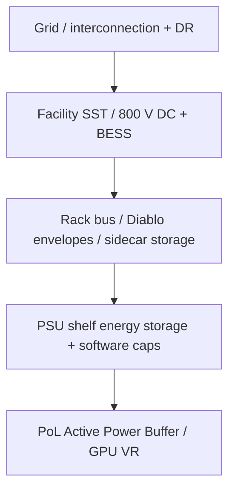

## At a glance

PoL active buffering, **800 VDC** facility/rack stacks, and grid demand-response. Name the electrical boundary before importing densification claims. Target mix **~50% industry / 30% academia / 20% adjacent**; seed papers (POLCA, TAPAS, DynamoLLM, PIP, Prometheus) are excluded from this shortlist.

{: w="1280" h="820" }
_Figure 1. Challenges differ by scale — server, rack, enterprise room, hyperscale DC, and grid._

## Reference: challenges by scale

| Scale | Dominant power problems | Anchor sources |
| --- | --- | --- |
| Server / PoL | Sub-ms–ms GPU spikes (~1.75× rated); VR/PDN UVP; passive 12 V bulk stores little energy → active floating $$C_{\mathrm{bulk}}$$ | Gu APEC 2026; WeChat APB summary |
| Rack / PDU | 100s kW→MW ambitions; copper at low V; stranded nameplate vs feeder; DC trip/coordination & capacitive discharge | NVIDIA 800 VDC; Eaton WP; Vertiv; Uptime 2026 |
| Enterprise / university room | Building feeder, UPS runtime, floor load, air/liquid lag GPU TDP; retrofit MEP cost; cooling–power coupling | CASC 2024 AI research DC guide |
| Hyperscale DC | MW–GW hierarchical budgets; PUE vs IT; multi-level caps; synchronized training swings | Choukse 2508.14318; GB300; nvPAX; Uptime PUE |
| Grid | Low-inertia surge/dip; periodic training bands → forced oscillations; interconnection queues; DR as alternative to buildout | Li 2409.11416; Ko & Zhu 2508.16457; Emerald; National Grid |

## Spotlight — Active Power Buffer sizing

For a floating bulk at the GPU/IBC 12 V side, differential energy must be absorbed locally. A useful sizing sketch:

$$
C_{\mathrm{bulk}} \;\gtrsim\; \frac{2\,\Delta E}{V_{\max}^{2}-V_{\min}^{2}}
$$

where $$\Delta E$$ is the energy of the GPU power spike above the upstream average. Upstream PSU/IBC can then be sized nearer average power — expanding stranded-power headroom for oversubscription.

> Prototype claims in Gu et al. (APEC 2026) cite line-side peak reductions up to ~45% and ms-scale peaks to ~1.75× rated. Verify against your VR UVP and trip curves before adopting the number.
{: .prompt-warning }

## Key developments (fresh shortlist)

### Industry

**NVIDIA 800 VDC AI-factory architecture** (2025-05-20). Moves conversion from ~54 V in-rack toward facility/row 800 VDC for 100 kW–1 MW+ racks, with a vendor efficiency claim of ~5% vs 54 V copper paths. Rebuild rack oversubscription models for 800 VDC trip envelopes before importing densification claims.  
[NVIDIA Developer blog](https://developer.nvidia.com/blog/nvidia-800-v-hvdc-architecture-will-power-the-next-generation-of-ai-factories/) · [Technology page](https://www.nvidia.com/en-us/data-center/technologies/800-vdc-architecture/)

**Vertiv 800 VDC portfolio for H2 2026** (2025-05-19). Aligns with NVIDIA’s architecture for >300 kW racks. Procurement calendars now have a named vendor window.  
[Vertiv news release](https://www.vertiv.com/en-us/about/news-and-insights/news-releases/vertiv-accelerates-ai-infrastructure-evolution-in-alignment-with-nvidia-800-vdc-power-architecture-announcement/)

**Eaton deploying 800VDC architecture white paper** (Jan 2026). SST → 800 VDC busway, solid-state breaker coordination, capacitive inrush, OCP Diablo-style step-load envelopes (±3% voltage). Trip curves dominate usable oversubscription once voltage rises.  
[Eaton white paper (PDF)](https://www.eaton.com/content/dam/eaton/markets/data-center/the-impact-of-ai/whitepapers/eaton-deploying-800vdc-architecture-whitepaper-en-us.pdf)

**GB300 NVL72 steady power + shelf storage** (2025-07-28). Energy-storage-enhanced PSU shelves (~65 J/GPU) plus power-cap/burner ramps; Megatron example cites ~30% lower peak grid demand. Companion framing in Choukse et al. ([arXiv:2508.14318](https://arxiv.org/abs/2508.14318)). Distinct from MaxLPS/DSX — this is the PSU-shelf layer.  
[NVIDIA Developer blog](https://developer.nvidia.com/blog/how-new-gb300-nvl72-features-provide-steady-power-for-ai/)

**UK National Grid + Nebius / Emerald AI trial** (2026-03-02). Up to ~40% demand cut in under a minute and sustained cuts up to ~10 h on a 96× Blackwell Ultra cluster. Facility-level cap channels for grid events sit beside intra-cluster densification.  
[National Grid](https://www.nationalgrid.com/uk-first-trial-ai-grid-technology-successfully-demonstrates-ability-data-centres-adjust-power-needs) · [Emerald AI case study](https://www.nvidia.com/en-us/case-studies/emerald-ai/)

### Academia

**Gu et al. PoL Active Power Buffer** (APEC 2026). Bidirectional converter + floating $$C_{\mathrm{bulk}}$$ at the GPU/IBC 12 V side. Primary paper behind the WeChat Active Power Buffer reading.  
[DOI 10.1109/apec51134.2026.11516732](https://doi.org/10.1109/apec51134.2026.11516732)

**nvPAX hierarchical feasible capping** ([arXiv:2605.01837](https://arxiv.org/abs/2605.01837)). Hybrid QP/LP allocator on tree PDNs with tenant priorities; H100-telemetry simulation (>12k GPUs), mean satisfaction ~98.9%, solve ~265 ms.

**Datacenter energy-optimized power profiles** ([arXiv:2510.03872](https://arxiv.org/abs/2510.03872)). Firmware power floors ↔ cluster efficiency under latency constraints — another knob between decode caps and rack storage.

### Adjacent / grid

**Emerald Phoenix field cut** ([arXiv:2507.00909](https://arxiv.org/abs/2507.00909)). 256× A100 in OCI, 25% cluster cut for 3 h on utility peaks with SLA-tagged jobs.

**Wide-area oscillations from AI training bands** (Ko & Zhu, [arXiv:2508.16457](https://arxiv.org/abs/2508.16457); complements Li et al. [arXiv:2409.11416](https://arxiv.org/abs/2409.11416)). Capping/smoothing is a reliability control for the grid, not only a TCO lever inside the DC.

## Stack diagram

