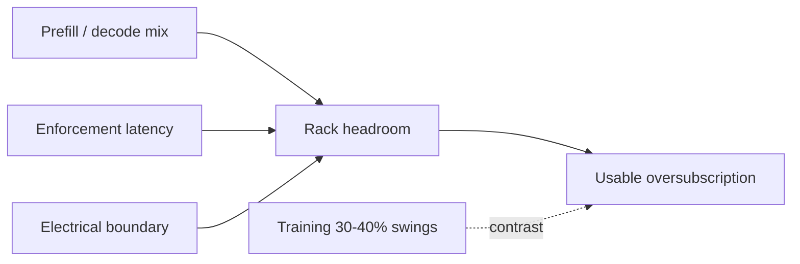

## At a glance

[Azure](https://azure.microsoft.com/ "Microsoft's cloud. Azure-lineage in these posts means power research from Microsoft Azure Research such as POLCA, TAPAS and DynamoLLM.")-lineage work shows LLM inference leaves rack/cluster headroom; the [NVIDIA](https://www.nvidia.com/en-us/ "US maker of GPUs, AI rack systems, networking and the software stack used in most AI data centers.") factory stack positions dynamic reclaim of stranded watts; [Meta](https://en.wikipedia.org/wiki/Meta_Platforms "Meta Platforms, a hyperscaler that builds its own AI training clusters and co-authors OCP power specs.") training is the contrast case with 30–40% swings. Usable [oversubscription](https://arxiv.org/abs/2308.12908 "Deploying more IT load than the power infrastructure could carry if everything peaked at once, relying on statistical headroom plus capping to stay within limits.") is limited by the electrical boundary and enforcement speed under inference [SLOs](https://en.wikipedia.org/wiki/Service-level_objective "Service-level objective: a latency or throughput target, such as time-to-first-token, that power caps must not violate.").

> Treat peak power and [ramp rate](https://arxiv.org/abs/2508.14318 "How fast a load changes its draw, in MW per minute or per second; utilities may cap ramp-up and ramp-down rates separately from peak MW.") as separate constraints. [Prefill and decode](https://arxiv.org/abs/2403.02310 "The two phases of LLM inference: prefill processes the whole prompt in parallel and is compute-bound; decode emits one token per step and is memory-bandwidth-bound, so the two draw power very differently.") are different electrical signatures — do not import a single “LLM headroom” number across phases.
{: .prompt-info }

{: w="1280" h="820" }
_Figure 1. Name the electrical boundary (VR → IBC → rack bus → MSB → grid) before importing any “more GPUs per MW” claim._

## Key developments

### 1. LLM inference headroom — POLCA / TAPAS · academia

Patel et al. (**[POLCA](https://arxiv.org/abs/2308.12908 "POLCA: Power Oversubscription in LLM Cloud Providers, Patel et al., Microsoft, ASPLOS 2024; characterizes LLM power headroom and an oversubscription and capping framework.")**, [ASPLOS](https://en.wikipedia.org/wiki/International_Conference_on_Architectural_Support_for_Programming_Languages_and_Operating_Systems "ACM Conference on Architectural Support for Programming Languages and Operating Systems, a top computer-systems venue.") 2024) characterize power-management opportunities for LLMs in the cloud and report on the order of **~30% more servers** under oversubscription. Stojkovic et al. (**[TAPAS](https://arxiv.org/abs/2501.02600 "TAPAS: Thermal- and Power-Aware Scheduling for LLM Inference in Cloud Platforms, Stojkovic et al., Microsoft and UIUC.")**) add thermal + power-aware scheduling with capacity-gain claims around **~40%**. Prefill vs decode must be treated as different electrical signatures.

**Implication.** Decode/prefill phase mix sets how much rack headroom is actually reclaimable under SLO.

- [POLCA DOI 10.1145/3620666.3651329](https://doi.org/10.1145/3620666.3651329)
- [POLCA arXiv:2308.12908](https://arxiv.org/abs/2308.12908)
- [TAPAS DOI 10.1145/3676641.3716025](https://doi.org/10.1145/3676641.3716025)
- [TAPAS arXiv:2501.02600](https://arxiv.org/abs/2501.02600)

### 2. Energy-aware serving — DynamoLLM · academia

**[DynamoLLM](https://arxiv.org/abs/2408.00741 "DynamoLLM: Designing LLM Inference Clusters for Performance and Energy Efficiency, Stojkovic et al., HPCA 2025; reconfigures serving for energy under SLOs.")** ([HPCA](https://en.wikipedia.org/wiki/International_Symposium_on_High-Performance_Computer_Architecture "IEEE International Symposium on High-Performance Computer Architecture.") 2025) reports large energy and cost reductions under SLOs via energy-aware serving reconfiguration; **[throttLL'eM](https://arxiv.org/abs/2408.05235 "throttLL'eM: SLO-aware GPU frequency scaling for energy-efficient LLM inference serving, Kakolyris et al., HPCA 2025.")** is the companion throttling study in the same cycle.

**Implication.** Serving reconfiguration is a peer to hard power caps when reclaiming inference energy under latency budgets.

- [DynamoLLM DOI 10.1109/HPCA61900.2025.00102](https://doi.org/10.1109/HPCA61900.2025.00102)
- [DynamoLLM arXiv:2408.00741](https://arxiv.org/abs/2408.00741)
- [throttLL'eM DOI 10.1109/HPCA61900.2025.00103](https://doi.org/10.1109/HPCA61900.2025.00103)
- [throttLL'eM arXiv:2408.05235](https://arxiv.org/abs/2408.05235)

### 3. NVIDIA MaxLPS / DSX stranded rack power · industry

NVIDIA positions **[MaxLPS / DSX](https://developer.nvidia.com/blog/maximizing-ai-factory-performance-per-watt-with-nvidia-dsx-maxlps/ "NVIDIA DSX is its AI-factory reference platform; MaxLPS is a DSX capability that maximizes throughput within a fixed power budget by dynamic power allocation and performance-per-watt tuning. Vendor claims.")** to reclaim stranded rack power in AI factories. Vendor-side claims (e.g. [Lambda](https://lambda.ai/ "Lambda: a GPU cloud and AI infrastructure provider.") reporting) cite roughly **~24% higher token throughput** on a fixed power budget — independently unverified; treat as a directional industry signal.

**Implication.** Factory software reclaim of stranded watts is the industry counterpart to academic oversubscription schedulers.

- [Maximizing AI factory performance per watt with DSX MaxLPS](https://developer.nvidia.com/blog/maximizing-ai-factory-performance-per-watt-with-nvidia-dsx-maxlps/)
- [From megawatts to tokens — NVIDIA AI factory production](https://blogs.nvidia.com/blog/from-megawatts-to-tokens-how-nvidia-maximizes-ai-factory-production/)

### 4. Meta Prometheus / Dynamo Dimmer — training contrast · industry

Meta Engineering describes **[Prometheus](https://engineering.fb.com/2026/10/19/data-center-engineering/inside-prometheus-meta-gigawatt-scale-supercluster/ "Meta's gigawatt-scale AI supercluster, described by Meta Engineering in Oct 2026, provisioned below TDP with hierarchy-aware capping.")** for gigawatt-scale superclusters: provisioning below [TDP](https://en.wikipedia.org/wiki/Thermal_design_power "Thermal design power: the sustained power a chip or PSU is rated to dissipate; GPU power floors and caps are expressed as a percent of TDP.") with hierarchy-aware capping under **30–40%** training power swings. The [Dynamo Dimmer](https://arxiv.org/abs/2605.24461 "The posts' label for Meta's companion preprint arXiv:2605.24461, Provisioning to Runtime Optimization of a 100 MW-Scale AI Cluster, Ardestani et al.; the name Dimmer does not appear in the arXiv abstract.") companion preprint frames the software capping layer. This is the **contrast case** for inference-side oversubscription.

**Implication.** Training swing amplitude sets a different feasible region than inference SLO-capped reclaim — do not mix the two without naming the workload.

- [Inside Prometheus — Meta Engineering](https://engineering.fb.com/2026/10/19/data-center-engineering/inside-prometheus-meta-gigawatt-scale-supercluster/)
- [arXiv:2605.24461 — Dynamo Dimmer companion](https://arxiv.org/abs/2605.24461)

{: w="1280" h="720" }
_Figure 2. Inference reclaim vs training swing — different feasible regions for oversubscription._

## Systems insight

Keep inference densification and training capping in separate columns of any comparison table. Vendor throughput-per-watt claims need an independent measurement plan before they enter capacity models.

## Glossary

_Hover any linked term above for a quick definition; click it for the source._

- [**ASPLOS**](https://en.wikipedia.org/wiki/International_Conference_on_Architectural_Support_for_Programming_Languages_and_Operating_Systems): ACM Conference on Architectural Support for Programming Languages and Operating Systems, a top computer-systems venue.
- [**Azure**](https://azure.microsoft.com/): Microsoft's cloud. Azure-lineage in these posts means power research from Microsoft Azure Research such as POLCA, TAPAS and DynamoLLM.
- [**Dynamo Dimmer**](https://arxiv.org/abs/2605.24461): The posts' label for Meta's companion preprint arXiv:2605.24461, Provisioning to Runtime Optimization of a 100 MW-Scale AI Cluster, Ardestani et al.; the name Dimmer does not appear in the arXiv abstract.
- [**DynamoLLM**](https://arxiv.org/abs/2408.00741): DynamoLLM: Designing LLM Inference Clusters for Performance and Energy Efficiency, Stojkovic et al., HPCA 2025; reconfigures serving for energy under SLOs.
- [**HPCA**](https://en.wikipedia.org/wiki/International_Symposium_on_High-Performance_Computer_Architecture): IEEE International Symposium on High-Performance Computer Architecture.
- [**IBC**](https://en.wikipedia.org/wiki/DC-to-DC_converter): Intermediate bus converter: a DC-DC stage that steps a rack bus, such as 54 V or 800 V, down to an intermediate board bus such as 12 V that feeds the PoL regulators.
- [**Lambda**](https://lambda.ai/): Lambda: a GPU cloud and AI infrastructure provider.
- [**MaxLPS / DSX**](https://developer.nvidia.com/blog/maximizing-ai-factory-performance-per-watt-with-nvidia-dsx-maxlps/): NVIDIA DSX is its AI-factory reference platform; MaxLPS is a DSX capability that maximizes throughput within a fixed power budget by dynamic power allocation and performance-per-watt tuning. Vendor claims.
- [**Meta**](https://en.wikipedia.org/wiki/Meta_Platforms): Meta Platforms, a hyperscaler that builds its own AI training clusters and co-authors OCP power specs.
- [**MSB**](https://en.wikipedia.org/wiki/Electric_switchboard): Main switchboard: the facility's primary low-voltage distribution board fed from the utility transformer.
- [**NVIDIA**](https://www.nvidia.com/en-us/): US maker of GPUs, AI rack systems, networking and the software stack used in most AI data centers.
- [**Oversubscription**](https://arxiv.org/abs/2308.12908): Deploying more IT load than the power infrastructure could carry if everything peaked at once, relying on statistical headroom plus capping to stay within limits.
- [**POLCA**](https://arxiv.org/abs/2308.12908): POLCA: Power Oversubscription in LLM Cloud Providers, Patel et al., Microsoft, ASPLOS 2024; characterizes LLM power headroom and an oversubscription and capping framework.
- [**Prefill / decode**](https://arxiv.org/abs/2403.02310): The two phases of LLM inference: prefill processes the whole prompt in parallel and is compute-bound; decode emits one token per step and is memory-bandwidth-bound, so the two draw power very differently.
- [**Prometheus**](https://engineering.fb.com/2026/10/19/data-center-engineering/inside-prometheus-meta-gigawatt-scale-supercluster/): Meta's gigawatt-scale AI supercluster, described by Meta Engineering in Oct 2026, provisioned below TDP with hierarchy-aware capping.
- [**Ramp rate, MW/min**](https://arxiv.org/abs/2508.14318): How fast a load changes its draw, in MW per minute or per second; utilities may cap ramp-up and ramp-down rates separately from peak MW.
- [**SLO**](https://en.wikipedia.org/wiki/Service-level_objective): Service-level objective: a latency or throughput target, such as time-to-first-token, that power caps must not violate.
- [**TAPAS**](https://arxiv.org/abs/2501.02600): TAPAS: Thermal- and Power-Aware Scheduling for LLM Inference in Cloud Platforms, Stojkovic et al., Microsoft and UIUC.
- [**TDP**](https://en.wikipedia.org/wiki/Thermal_design_power): Thermal design power: the sustained power a chip or PSU is rated to dissipate; GPU power floors and caps are expressed as a percent of TDP.
- [**throttLL'eM**](https://arxiv.org/abs/2408.05235): throttLL'eM: SLO-aware GPU frequency scaling for energy-efficient LLM inference serving, Kakolyris et al., HPCA 2025.
- [**VR**](https://en.wikipedia.org/wiki/Voltage_regulator_module): Voltage regulator, or VRM: the multiphase converter that feeds the processor core rail and must hold voltage through fast current steps.
