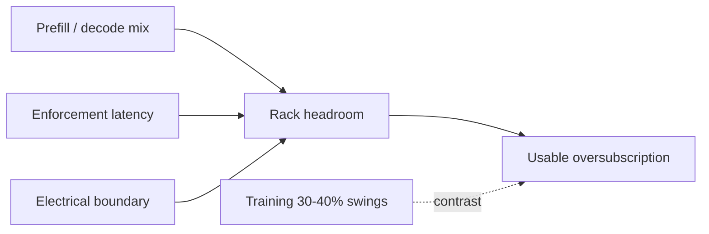

## At a glance

Azure-lineage work shows LLM inference leaves rack/cluster headroom; the NVIDIA factory stack positions dynamic reclaim of stranded watts; Meta training is the contrast case with 30–40% swings. Usable oversubscription is limited by the electrical boundary and enforcement speed under inference SLOs.

> Treat peak power and ramp rate as separate constraints. Prefill and decode are different electrical signatures — do not import a single “LLM headroom” number across phases.
{: .prompt-info }

{: w="1280" h="820" }
_Figure 1. Name the electrical boundary (VR → IBC → rack bus → MSB → grid) before importing any “more GPUs per MW” claim._

## Key developments

### 1. LLM inference headroom — POLCA / TAPAS · academia

Patel et al. (**POLCA**, ASPLOS 2024) characterize power-management opportunities for LLMs in the cloud and report on the order of **~30% more servers** under oversubscription. Stojkovic et al. (**TAPAS**) add thermal + power-aware scheduling with capacity-gain claims around **~40%**. Prefill vs decode must be treated as different electrical signatures.

**Implication.** Decode/prefill phase mix sets how much rack headroom is actually reclaimable under SLO.

- [POLCA DOI 10.1145/3620666.3651329](https://doi.org/10.1145/3620666.3651329)
- [POLCA arXiv:2308.12908](https://arxiv.org/abs/2308.12908)
- [TAPAS DOI 10.1145/3676641.3716025](https://doi.org/10.1145/3676641.3716025)
- [TAPAS arXiv:2501.02600](https://arxiv.org/abs/2501.02600)

### 2. Energy-aware serving — DynamoLLM · academia

**DynamoLLM** (HPCA 2025) reports large energy and cost reductions under SLOs via energy-aware serving reconfiguration; **throttLL'eM** is the companion throttling study in the same cycle.

**Implication.** Serving reconfiguration is a peer to hard power caps when reclaiming inference energy under latency budgets.

- [DynamoLLM DOI 10.1109/HPCA61900.2025.00102](https://doi.org/10.1109/HPCA61900.2025.00102)
- [DynamoLLM arXiv:2408.00741](https://arxiv.org/abs/2408.00741)
- [throttLL'eM DOI 10.1109/HPCA61900.2025.00103](https://doi.org/10.1109/HPCA61900.2025.00103)
- [throttLL'eM arXiv:2408.05235](https://arxiv.org/abs/2408.05235)

### 3. NVIDIA MaxLPS / DSX stranded rack power · industry

NVIDIA positions **MaxLPS / DSX** to reclaim stranded rack power in AI factories. Vendor-side claims (e.g. Lambda reporting) cite roughly **~24% higher token throughput** on a fixed power budget — independently unverified; treat as a directional industry signal.

**Implication.** Factory software reclaim of stranded watts is the industry counterpart to academic oversubscription schedulers.

- [Maximizing AI factory performance per watt with DSX MaxLPS](https://developer.nvidia.com/blog/maximizing-ai-factory-performance-per-watt-with-nvidia-dsx-maxlps/)
- [From megawatts to tokens — NVIDIA AI factory production](https://blogs.nvidia.com/blog/from-megawatts-to-tokens-how-nvidia-maximizes-ai-factory-production/)

### 4. Meta Prometheus / Dynamo Dimmer — training contrast · industry

Meta Engineering describes **Prometheus** for gigawatt-scale superclusters: provisioning below TDP with hierarchy-aware capping under **30–40%** training power swings. The Dynamo Dimmer companion preprint frames the software capping layer. This is the **contrast case** for inference-side oversubscription.

**Implication.** Training swing amplitude sets a different feasible region than inference SLO-capped reclaim — do not mix the two without naming the workload.

- [Inside Prometheus — Meta Engineering](https://engineering.fb.com/2026/10/19/data-center-engineering/inside-prometheus-meta-gigawatt-scale-supercluster/)
- [arXiv:2605.24461 — Dynamo Dimmer companion](https://arxiv.org/abs/2605.24461)

{: w="1280" h="720" }
_Figure 2. Inference reclaim vs training swing — different feasible regions for oversubscription._

## Systems insight

Keep inference densification and training capping in separate columns of any comparison table. Vendor throughput-per-watt claims need an independent measurement plan before they enter capacity models.
