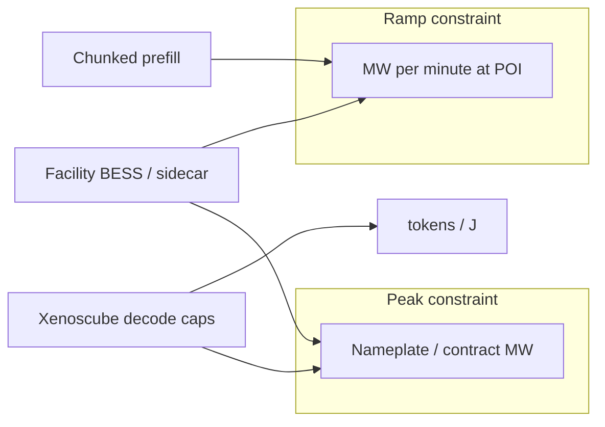

## At a glance

**[Envision](https://en.wikipedia.org/wiki/Envision_Energy "Envision: a Chinese clean-energy group known for wind turbines, batteries and energy software, which announced the Ulanqab 800 V DC SST plant.")** reports a live commercial [SST+BESS](https://www.eaton.com/content/dam/eaton/markets/data-center/the-impact-of-ai/whitepapers/eaton-deploying-800vdc-architecture-whitepaper-en-us.pdf "Solid-state transformer plus battery energy storage system: a power-electronic transformer that converts medium-voltage AC straight to a DC bus, paired with batteries on that bus so the plant can buffer load swings, ride through grid faults and bridge generator transfers.") **[800 V DC](https://www.nvidia.com/en-us/data-center/technologies/800-vdc-architecture/ "Distributing power to AI racks at 800 V direct current instead of 54 V DC in-rack or 415/480 V AC, which cuts current and copper for 100 kW to 1 MW racks.")** plant; **[Schneider](https://en.wikipedia.org/wiki/Schneider_Electric "French multinational supplying electrical distribution, UPS, and data-center power and cooling equipment and software.")** outlines [sidecar](https://techcommunity.microsoft.com/blog/azureinfrastructureblog/mt-diablo---disaggregated-power-fueling-the-next-wave-of-ai-platforms/4268799 "A separate power rack beside the IT rack that holds PSUs, batteries and capacitors and feeds the IT rack over DC cables or busbar, as in Mt. Diablo and NVIDIA Kyber.") storage on an 800 V / ±400 V [Diablo](https://www.opencompute.org/wp-content/uploads/2026/10/OCP-Specification-Mt.-Diablo-Disaggregated-Power-Rack-Specification-v1.0.0.pdf "Mt. Diablo, formerly Diablo 400: an Open Compute Project sidecar power-rack spec authored by Microsoft, Meta and Google that feeds IT racks at plus/minus 400 VDC, i.e. differential 800 VDC, with step-load envelopes such as 3 percent max voltage transient. It is an OCP spec, not an NVIDIA product.") path; **[Xenoscube](https://arxiv.org/abs/2609.11133 "The brief's shorthand for arXiv:2609.11133, Phase-Decoupled, Model-Calibrated Power Control for Disaggregated LLM Serving, Kim et al.; the name Xenoscube does not appear on the arXiv page.")** calibrated [decode](https://arxiv.org/abs/2403.02310 "The two phases of LLM inference: prefill processes the whole prompt in parallel and is compute-bound; decode emits one token per step and is memory-bandwidth-bound, so the two draw power very differently.") caps reverse [POLCA](https://arxiv.org/abs/2308.12908 "POLCA: Power Oversubscription in LLM Cloud Providers, Patel et al., Microsoft, ASPLOS 2024; characterizes LLM power headroom and an oversubscription and capping framework.")-style preference assumptions on decode; **[Ember](https://ember-energy.org/ "Ember: an independent energy think tank that publishes open electricity data and analysis.") / [PJM](https://www.pjm.com/ "PJM Interconnection: the regional transmission organization that runs the grid and wholesale power markets for all or parts of 13 eastern US states and DC, including the Northern Virginia data-center hub.")** show inference inflexibility and volatile large-load forecasts. Treat **peak** and **ramp** as separate constraints.

> Mix for this weekday digest: ~50% industry / 30% academia / 20% adjacent.
{: .prompt-tip }

{: w="1386" h="854" }
_Figure 1. Facility SST → rack Diablo envelopes → PSU-shelf storage → PoL buffer. Vendor PR claims remain unverified._

## Key developments

### 1. Envision commercial 800V DC SST+BESS · Nov 2 2026 · industry

Envision reports the first commercial integrated **800 V DC [SST](https://en.wikipedia.org/wiki/Solid-state_transformer "Solid-state transformer: a transformer built from high-frequency power electronics instead of a large 50/60 Hz iron core; in AI data centers it can step medium-voltage AC directly to 800 VDC.")-based** power system in a large-scale AI data center at the [Ulanqab](https://en.wikipedia.org/wiki/Ulanqab "City in Inner Mongolia, China, a large data-center hub thanks to cool climate and abundant power.") Galaxy campus: 10 kV AC stepped to 800 V DC, with a [Dubhe](https://www.prnewswire.com/news-releases/envision-achieves-worlds-first-commercial-deployment-of-integrated-800v-dc-sst-based-power-system-in-large-scale-ai-data-center-302926109.html "Envision's name for the millisecond-level controller in its SST-based 800 V DC system. Vendor term.") millisecond controller and [BESS](https://en.wikipedia.org/wiki/Battery_energy_storage_system "Battery energy storage system: battery cells plus inverters, telemetry and controls that absorb or inject power in real time; used at AI sites for ramp smoothing, ride-through and backup transfer.") coupling. Roadmap cites multi-GW scale (planned ~3 GW). **Vendor PR** — treat efficiency and footprint claims as unverified.

**Implication.** Facility-side 800 V DC is no longer only architecture slides; live plants change what rack [PDU](https://en.wikipedia.org/wiki/Power_distribution_unit "Power distribution unit: the rack- or row-level device that splits and protects feeder power to racks or shelves.") and trip models must assume.

- [Envision PR — PR Newswire](https://www.prnewswire.com/news-releases/envision-achieves-worlds-first-commercial-deployment-of-integrated-800v-dc-sst-based-power-system-in-large-scale-ai-data-center-302926109.html)
- [Tom's Hardware coverage](https://www.tomshardware.com/tech-industry/data-centers/china-deploys-worlds-first-800-volt-dc-power-system-for-massive-ai-data-center-seeks-to-quench-power-needs-with-higher-conversion-and-efficiency-inside-a-smaller-footprint)

### 2. Schneider sidecar + 800V / ±400V Diablo path · Nov 3 2026 · industry

Schneider Electric (Carlini interview) outlines **sidecar** battery/capacitor modules and an 800 V / +/-400 V path aligned with OCP **Diablo** step-load envelopes for [NVIDIA](https://www.nvidia.com/en-us/ "US maker of GPUs, AI rack systems, networking and the software stack used in most AI data centers.") [Rubin Ultra](https://developer.nvidia.com/blog/nvidia-800-v-hvdc-architecture-will-power-the-next-generation-of-ai-factories/ "The higher-power Rubin GPU variant NVIDIA plans for 2027 in Kyber racks, the first generation designed around 800 VDC power delivery.")–class racks (~2027). Facility conversion and local energy storage are co-designed with AI step loads rather than bolt-on [UPS](https://en.wikipedia.org/wiki/Uninterruptible_power_supply "Uninterruptible power supply: batteries plus converters that keep IT running through outages; some now offer power-smoothing modes.") only.

**Implication.** Rack [oversubscription](https://arxiv.org/abs/2308.12908 "Deploying more IT load than the power infrastructure could carry if everything peaked at once, relying on statistical headroom plus capping to stay within limits.") math must include sidecar storage response time and Diablo voltage envelopes, not only nameplate GPU [TDP](https://en.wikipedia.org/wiki/Thermal_design_power "Thermal design power: the sustained power a chip or PSU is rated to dissipate; GPU power floors and caps are expressed as a percent of TDP.").

- [Capacity Media — Steve Carlini interview](https://capacityglobal.com/news/schneider-electric-steve-carlini-interview/)
- [NVIDIA 800 V HVDC architecture](https://developer.nvidia.com/blog/nvidia-800-v-hvdc-architecture-will-power-the-next-generation-of-ai-factories/)

### 3. PJM revised data-center backstop procurement · Nov 3 2026 · industry / grid

[Utility Dive](https://en.wikipedia.org/wiki/Utility_Dive "Utility Dive: a trade publication covering US electric utilities and grid regulation.") reports PJM revising its data-center [backstop procurement](https://www.pjm.com/-/media/DotCom/committees-groups/cifp-rbp/2026/20260630/20260630-item-02a---pjm-stage-4-proposal---reliability-backstop-procurement---executive-summary.pdf "PJM Reliability Backstop Procurement, RBP: a one-time procurement of new capacity to cover a 2028/29 shortfall driven mainly by data-center load growth; FERC rejected most of the first design in Sept 2026 and PJM refiled on Oct 29, 2026.") after [FERC](https://en.wikipedia.org/wiki/Federal_Energy_Regulatory_Commission "Federal Energy Regulatory Commission: the US regulator of interstate transmission and wholesale power markets, which must approve PJM and other RTO rule changes.") process pressure. [Jefferies](https://www.jefferies.com/ "US investment bank; its analysts estimated the revised PJM backstop procurement could shrink to about 630 MW.") estimates **~630 MW** vs a prior **~6.8 GW** framing — large-load interconnection forecasts remain volatile and politically contested.

**Implication.** Campus and [colo](https://en.wikipedia.org/wiki/Colocation_centre "Colocation or colo: a data center that rents space, power and cooling to many tenants.") power plans should treat [interconnection queue](https://emp.lbl.gov/queues "The list of projects waiting for transmission impact studies before they may connect to the grid; for large loads these studies can take years.") numbers as scenarios, not fixed headroom for AI densification.

- [Utility Dive](https://www.utilitydive.com/news/pjm-revised-data-center-backstop-procurement-ferc/873551/)

### 4. Phase-decoupled calibrated decode caps — Xenoscube · academia

[arXiv:2609.11133](https://arxiv.org/abs/2609.11133) evaluates phase-decoupled, calibrated decode power caps on an 8×[B200](https://en.wikipedia.org/wiki/Blackwell_%28microarchitecture%29 "NVIDIA's 2024-2025 data-center GPU generation; B200 is the base GPU and Blackwell Ultra, used in GB300, is the higher-power refresh.") [Dynamo](https://github.com/ai-dynamo/dynamo "NVIDIA Dynamo: open-source distributed LLM inference-serving framework that supports disaggregated prefill and decode.")-style serving stack. Reports **+20.4% [tokens/J](https://arxiv.org/abs/2609.11133 "Tokens generated per joule of energy, an inference energy-efficiency metric.")** vs [Max-Q](https://developer.nvidia.com/blog/optimize-data-center-efficiency-for-ai-and-hpc-workloads-with-power-profiles/ "NVIDIA Max-Q workload power profiles, MAX-Q Training and MAX-Q Inference on Blackwell systems: preset GPU power and clock settings that trade some peak speed for better performance per watt; the throughput-first counterpart is Max-P.") baselines and challenges POLCA-style preference assumptions on the decode phase: decode is **not** uniformly the soft electrical slack earlier [Azure](https://azure.microsoft.com/ "Microsoft's cloud. Azure-lineage in these posts means power research from Microsoft Azure Research such as POLCA, TAPAS and DynamoLLM.")-lineage work suggested.

**Implication.** Inference oversubscription policies should recalibrate decode caps from telemetry, not import POLCA decode headroom wholesale.

### 5. Chunked prefill as a ramp lever · academia

[arXiv:2608.01250](https://arxiv.org/abs/2608.01250): [chunked prefill](https://arxiv.org/abs/2403.02310 "An LLM-serving scheduling technique, popularised by SARATHI and Sarathi-Serve, that splits a long prompt's prefill into fixed-size chunks and interleaves them with decode steps; it smooths latency and, per arXiv:2608.01250, power ramp rate.") leaves **peak MW** largely unchanged while cutting power **ramp ([MW/min](https://arxiv.org/abs/2508.14318 "How fast a load changes its draw, in MW per minute or per second; utilities may cap ramp-up and ramp-down rates separately from peak MW."))** by roughly **7% to 34.6%** depending on chunking.

**Implication.** For [POI](https://en.wikipedia.org/wiki/Point_of_common_coupling "Point of interconnection: where the site connects to the utility grid and where contract limits such as peak MW and ramp MW/min are measured.") contracts that bill or curtail on ramp, chunked prefill is a software control orthogonal to peak capping.

{: w="1386" h="756" }
_Figure 2. Peak MW contract can stay flat while ramp MW/min falls under chunked prefill — orthogonal levers._

### 6. Ember: data-centre flexibility potential · Oct 29 2026 · adjacent

Ember estimates only **~3%** of global data-centre capacity is flexible by 2030 under current trajectories; [behind-the-meter](https://en.wikipedia.org/wiki/Distributed_generation "Generation or storage on the customer side of the utility meter that serves the load directly rather than through the grid.") generation can deliver **~5×** more grid relief than load shifting alone. Inference loads look **~5%** flexible vs **~35%** for training — a structural limit for [DR](https://en.wikipedia.org/wiki/Demand_response "Demand response, DR: a large customer cuts or shifts consumption when the grid is stressed, in exchange for payment or faster interconnection, as an alternative to building new supply.")-based interconnection deals.

**Implication.** Do not assume inference clusters can absorb the same DR duty cycle as training batches when negotiating flexible interconnects.

- [Ember insight](https://ember-energy.org/latest-insights/data-centres-for-grids-the-potential-impact-of-flexibility/)
- [PV Magazine summary](https://www.pv-magazine.com/2026/11/03/behind-the-meter-generation-could-deliver-five-times-more-grid-relief-than-data-center-load-shifting/)

## Spotlight

Peak MW vs ramp MW/min at the POI. A calibrated decode-cap sketch:

$$
R^{\star} \approx z_{\varepsilon}\,\sqrt{N}\,\sigma
$$

Calibrated decode caps can beat Max-Q on tok/J **without** assuming POLCA-style preference on decode.

## Glossary

_Hover any linked term above for a quick definition; click it for the source._

- [**800 VDC**](https://www.nvidia.com/en-us/data-center/technologies/800-vdc-architecture/): Distributing power to AI racks at 800 V direct current instead of 54 V DC in-rack or 415/480 V AC, which cuts current and copper for 100 kW to 1 MW racks.
- [**Azure**](https://azure.microsoft.com/): Microsoft's cloud. Azure-lineage in these posts means power research from Microsoft Azure Research such as POLCA, TAPAS and DynamoLLM.
- [**Backstop procurement**](https://www.pjm.com/-/media/DotCom/committees-groups/cifp-rbp/2026/20260630/20260630-item-02a---pjm-stage-4-proposal---reliability-backstop-procurement---executive-summary.pdf): PJM Reliability Backstop Procurement, RBP: a one-time procurement of new capacity to cover a 2028/29 shortfall driven mainly by data-center load growth; FERC rejected most of the first design in Sept 2026 and PJM refiled on Oct 29, 2026.
- [**Behind-the-meter**](https://en.wikipedia.org/wiki/Distributed_generation): Generation or storage on the customer side of the utility meter that serves the load directly rather than through the grid.
- [**BESS**](https://en.wikipedia.org/wiki/Battery_energy_storage_system): Battery energy storage system: battery cells plus inverters, telemetry and controls that absorb or inject power in real time; used at AI sites for ramp smoothing, ride-through and backup transfer.
- [**Blackwell / Blackwell Ultra / B200**](https://en.wikipedia.org/wiki/Blackwell_%28microarchitecture%29): NVIDIA's 2024-2025 data-center GPU generation; B200 is the base GPU and Blackwell Ultra, used in GB300, is the higher-power refresh.
- [**Chunked prefill**](https://arxiv.org/abs/2403.02310): An LLM-serving scheduling technique, popularised by SARATHI and Sarathi-Serve, that splits a long prompt's prefill into fixed-size chunks and interleaves them with decode steps; it smooths latency and, per arXiv:2608.01250, power ramp rate.
- [**Colocation**](https://en.wikipedia.org/wiki/Colocation_centre): Colocation or colo: a data center that rents space, power and cooling to many tenants.
- [**Demand response**](https://en.wikipedia.org/wiki/Demand_response): Demand response, DR: a large customer cuts or shifts consumption when the grid is stressed, in exchange for payment or faster interconnection, as an alternative to building new supply.
- [**Dubhe controller**](https://www.prnewswire.com/news-releases/envision-achieves-worlds-first-commercial-deployment-of-integrated-800v-dc-sst-based-power-system-in-large-scale-ai-data-center-302926109.html): Envision's name for the millisecond-level controller in its SST-based 800 V DC system. Vendor term.
- [**Ember**](https://ember-energy.org/): Ember: an independent energy think tank that publishes open electricity data and analysis.
- [**Envision**](https://en.wikipedia.org/wiki/Envision_Energy): Envision: a Chinese clean-energy group known for wind turbines, batteries and energy software, which announced the Ulanqab 800 V DC SST plant.
- [**FERC**](https://en.wikipedia.org/wiki/Federal_Energy_Regulatory_Commission): Federal Energy Regulatory Commission: the US regulator of interstate transmission and wholesale power markets, which must approve PJM and other RTO rule changes.
- [**Interconnection queue**](https://emp.lbl.gov/queues): The list of projects waiting for transmission impact studies before they may connect to the grid; for large loads these studies can take years.
- [**Jefferies**](https://www.jefferies.com/): US investment bank; its analysts estimated the revised PJM backstop procurement could shrink to about 630 MW.
- [**Max-Q**](https://developer.nvidia.com/blog/optimize-data-center-efficiency-for-ai-and-hpc-workloads-with-power-profiles/): NVIDIA Max-Q workload power profiles, MAX-Q Training and MAX-Q Inference on Blackwell systems: preset GPU power and clock settings that trade some peak speed for better performance per watt; the throughput-first counterpart is Max-P.
- [**Mt. Diablo / OCP Diablo**](https://www.opencompute.org/wp-content/uploads/2026/10/OCP-Specification-Mt.-Diablo-Disaggregated-Power-Rack-Specification-v1.0.0.pdf): Mt. Diablo, formerly Diablo 400: an Open Compute Project sidecar power-rack spec authored by Microsoft, Meta and Google that feeds IT racks at plus/minus 400 VDC, i.e. differential 800 VDC, with step-load envelopes such as 3 percent max voltage transient. It is an OCP spec, not an NVIDIA product.
- [**NVIDIA**](https://www.nvidia.com/en-us/): US maker of GPUs, AI rack systems, networking and the software stack used in most AI data centers.
- [**NVIDIA Dynamo**](https://github.com/ai-dynamo/dynamo): NVIDIA Dynamo: open-source distributed LLM inference-serving framework that supports disaggregated prefill and decode.
- [**Oversubscription**](https://arxiv.org/abs/2308.12908): Deploying more IT load than the power infrastructure could carry if everything peaked at once, relying on statistical headroom plus capping to stay within limits.
- [**PDU**](https://en.wikipedia.org/wiki/Power_distribution_unit): Power distribution unit: the rack- or row-level device that splits and protects feeder power to racks or shelves.
- [**PJM**](https://www.pjm.com/): PJM Interconnection: the regional transmission organization that runs the grid and wholesale power markets for all or parts of 13 eastern US states and DC, including the Northern Virginia data-center hub.
- [**POI**](https://en.wikipedia.org/wiki/Point_of_common_coupling): Point of interconnection: where the site connects to the utility grid and where contract limits such as peak MW and ramp MW/min are measured.
- [**PoL**](https://en.wikipedia.org/wiki/DC-to-DC_converter): Point of load: the final DC-DC converter stage placed right next to the GPU or CPU, turning a board bus such as 12 V into the roughly 1 V core rail.
- [**POLCA**](https://arxiv.org/abs/2308.12908): POLCA: Power Oversubscription in LLM Cloud Providers, Patel et al., Microsoft, ASPLOS 2024; characterizes LLM power headroom and an oversubscription and capping framework.
- [**Prefill / decode**](https://arxiv.org/abs/2403.02310): The two phases of LLM inference: prefill processes the whole prompt in parallel and is compute-bound; decode emits one token per step and is memory-bandwidth-bound, so the two draw power very differently.
- [**PSU**](https://en.wikipedia.org/wiki/Power_supply_unit_%28computer%29): Power supply unit: converts AC or high-voltage DC input to the DC bus that servers use.
- [**PSU shelf**](https://developer.nvidia.com/blog/how-new-gb300-nvl72-features-provide-steady-power-for-ai/): A rack-mounted tray of hot-swappable power-supply units that converts AC or high-voltage DC to the rack bus; in GB300 NVL72 the PSUs also hold capacitors for energy storage.
- [**Ramp rate, MW/min**](https://arxiv.org/abs/2508.14318): How fast a load changes its draw, in MW per minute or per second; utilities may cap ramp-up and ramp-down rates separately from peak MW.
- [**Rubin Ultra**](https://developer.nvidia.com/blog/nvidia-800-v-hvdc-architecture-will-power-the-next-generation-of-ai-factories/): The higher-power Rubin GPU variant NVIDIA plans for 2027 in Kyber racks, the first generation designed around 800 VDC power delivery.
- [**Schneider Electric**](https://en.wikipedia.org/wiki/Schneider_Electric): French multinational supplying electrical distribution, UPS, and data-center power and cooling equipment and software.
- [**Sidecar**](https://techcommunity.microsoft.com/blog/azureinfrastructureblog/mt-diablo---disaggregated-power-fueling-the-next-wave-of-ai-platforms/4268799): A separate power rack beside the IT rack that holds PSUs, batteries and capacitors and feeds the IT rack over DC cables or busbar, as in Mt. Diablo and NVIDIA Kyber.
- [**SST**](https://en.wikipedia.org/wiki/Solid-state_transformer): Solid-state transformer: a transformer built from high-frequency power electronics instead of a large 50/60 Hz iron core; in AI data centers it can step medium-voltage AC directly to 800 VDC.
- [**SST+BESS**](https://www.eaton.com/content/dam/eaton/markets/data-center/the-impact-of-ai/whitepapers/eaton-deploying-800vdc-architecture-whitepaper-en-us.pdf): Solid-state transformer plus battery energy storage system: a power-electronic transformer that converts medium-voltage AC straight to a DC bus, paired with batteries on that bus so the plant can buffer load swings, ride through grid faults and bridge generator transfers.
- [**TDP**](https://en.wikipedia.org/wiki/Thermal_design_power): Thermal design power: the sustained power a chip or PSU is rated to dissipate; GPU power floors and caps are expressed as a percent of TDP.
- [**Tokens/J**](https://arxiv.org/abs/2609.11133): Tokens generated per joule of energy, an inference energy-efficiency metric.
- [**Ulanqab**](https://en.wikipedia.org/wiki/Ulanqab): City in Inner Mongolia, China, a large data-center hub thanks to cool climate and abundant power.
- [**UPS**](https://en.wikipedia.org/wiki/Uninterruptible_power_supply): Uninterruptible power supply: batteries plus converters that keep IT running through outages; some now offer power-smoothing modes.
- [**Utility Dive**](https://en.wikipedia.org/wiki/Utility_Dive): Utility Dive: a trade publication covering US electric utilities and grid regulation.
- [**Xenoscube**](https://arxiv.org/abs/2609.11133): The brief's shorthand for arXiv:2609.11133, Phase-Decoupled, Model-Calibrated Power Control for Disaggregated LLM Serving, Kim et al.; the name Xenoscube does not appear on the arXiv page.
