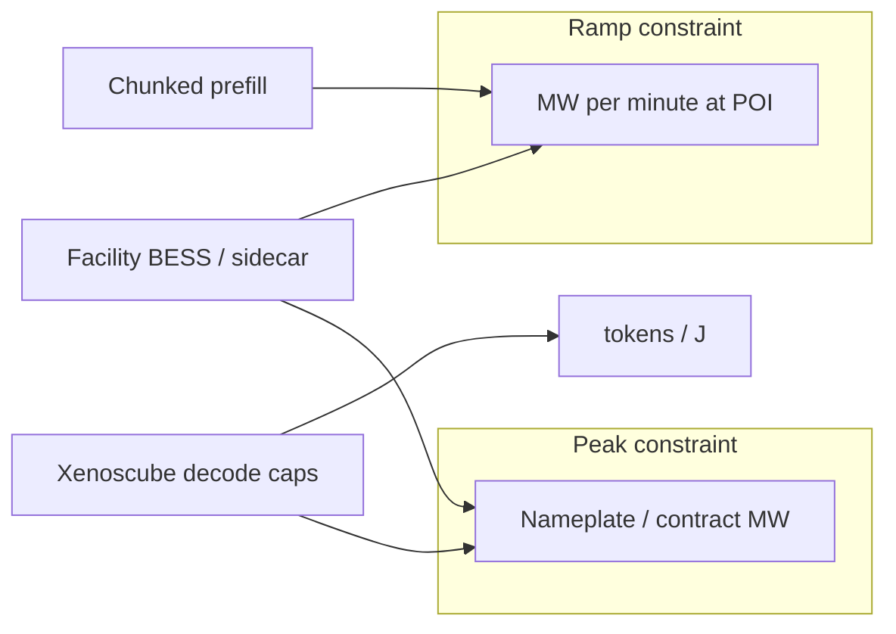

## At a glance

**Envision** reports a live commercial SST+BESS **800 V DC** plant; **Schneider** outlines sidecar storage on an 800 V / ±400 V Diablo path; **Xenoscube** calibrated decode caps reverse POLCA-style preference assumptions on decode; **Ember / PJM** show inference inflexibility and volatile large-load forecasts. Treat **peak** and **ramp** as separate constraints.

> Mix for this weekday digest: ~50% industry / 30% academia / 20% adjacent.
{: .prompt-tip }

{: w="1386" h="854" }
_Figure 1. Facility SST → rack Diablo envelopes → PSU-shelf storage → PoL buffer. Vendor PR claims remain unverified._

## Key developments

### 1. Envision commercial 800V DC SST+BESS · Nov 2 2026 · industry

Envision reports the first commercial integrated **800 V DC SST-based** power system in a large-scale AI data center at the Ulanqab Galaxy campus: 10 kV AC stepped to 800 V DC, with a Dubhe millisecond controller and BESS coupling. Roadmap cites multi-GW scale (planned ~3 GW). **Vendor PR** — treat efficiency and footprint claims as unverified.

**Implication.** Facility-side 800 V DC is no longer only architecture slides; live plants change what rack PDU and trip models must assume.

- [Envision PR — PR Newswire](https://www.prnewswire.com/news-releases/envision-achieves-worlds-first-commercial-deployment-of-integrated-800v-dc-sst-based-power-system-in-large-scale-ai-data-center-302926109.html)
- [Tom's Hardware coverage](https://www.tomshardware.com/tech-industry/data-centers/china-deploys-worlds-first-800-volt-dc-power-system-for-massive-ai-data-center-seeks-to-quench-power-needs-with-higher-conversion-and-efficiency-inside-a-smaller-footprint)

### 2. Schneider sidecar + 800V / ±400V Diablo path · Nov 3 2026 · industry

Schneider Electric (Carlini interview) outlines **sidecar** battery/capacitor modules and an 800 V / +/-400 V path aligned with NVIDIA **Diablo** step-load envelopes for Rubin Ultra–class racks (~2027). Facility conversion and local energy storage are co-designed with AI step loads rather than bolt-on UPS only.

**Implication.** Rack oversubscription math must include sidecar storage response time and Diablo voltage envelopes, not only nameplate GPU TDP.

- [Capacity Media — Steve Carlini interview](https://capacityglobal.com/news/schneider-electric-steve-carlini-interview/)
- [NVIDIA 800 V HVDC architecture](https://developer.nvidia.com/blog/nvidia-800-v-hvdc-architecture-will-power-the-next-generation-of-ai-factories/)

### 3. PJM revised data-center backstop procurement · Nov 3 2026 · industry / grid

Utility Dive reports PJM revising its data-center backstop procurement after FERC process pressure. Jefferies estimates **~630 MW** vs a prior **~6.8 GW** framing — large-load interconnection forecasts remain volatile and politically contested.

**Implication.** Campus and colo power plans should treat interconnection queue numbers as scenarios, not fixed headroom for AI densification.

- [Utility Dive](https://www.utilitydive.com/news/pjm-revised-data-center-backstop-procurement-ferc/873551/)

### 4. Phase-decoupled calibrated decode caps — Xenoscube · academia

[arXiv:2609.11133](https://arxiv.org/abs/2609.11133) evaluates phase-decoupled, calibrated decode power caps on an 8×B200 Dynamo-style serving stack. Reports **+20.4% tokens/J** vs Max-Q baselines and challenges POLCA-style preference assumptions on the decode phase: decode is **not** uniformly the soft electrical slack earlier Azure-lineage work suggested.

**Implication.** Inference oversubscription policies should recalibrate decode caps from telemetry, not import POLCA decode headroom wholesale.

### 5. Chunked prefill as a ramp lever · academia

[arXiv:2608.01250](https://arxiv.org/abs/2608.01250): chunked prefill leaves **peak MW** largely unchanged while cutting power **ramp (MW/min)** by roughly **7% to 34.6%** depending on chunking.

**Implication.** For POI contracts that bill or curtail on ramp, chunked prefill is a software control orthogonal to peak capping.

{: w="1386" h="756" }
_Figure 2. Peak MW contract can stay flat while ramp MW/min falls under chunked prefill — orthogonal levers._

### 6. Ember: data-centre flexibility potential · Oct 29 2026 · adjacent

Ember estimates only **~3%** of global data-centre capacity is flexible by 2030 under current trajectories; behind-the-meter generation can deliver **~5×** more grid relief than load shifting alone. Inference loads look **~5%** flexible vs **~35%** for training — a structural limit for DR-based interconnection deals.

**Implication.** Do not assume inference clusters can absorb the same DR duty cycle as training batches when negotiating flexible interconnects.

- [Ember insight](https://ember-energy.org/latest-insights/data-centres-for-grids-the-potential-impact-of-flexibility/)
- [PV Magazine summary](https://www.pv-magazine.com/2026/11/03/behind-the-meter-generation-could-deliver-five-times-more-grid-relief-than-data-center-load-shifting/)

## Spotlight

Peak MW vs ramp MW/min at the POI. A calibrated decode-cap sketch:

$$
R^{\star} \approx z_{\varepsilon}\,\sqrt{N}\,\sigma
$$

Calibrated decode caps can beat Max-Q on tok/J **without** assuming POLCA-style preference on decode.

