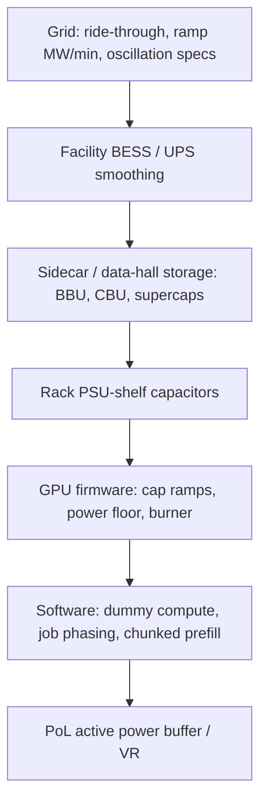

## At a glance

Large AI training jobs run thousands of GPUs in lockstep, so the whole cluster swings between near-[TDP](https://en.wikipedia.org/wiki/Thermal_design_power "Thermal design power: the sustained power a chip or PSU is rated to dissipate; GPU power floors and caps are expressed as a percent of TDP.") compute phases and near-idle communication phases. At scale that is tens to hundreds of MW moving in seconds, with spectral energy around 0.2–3 Hz, close to grid and generator resonances (Choukse et al., arXiv:2508.14318). Inference adds its own [prefill](https://arxiv.org/abs/2403.02310 "The two phases of LLM inference: prefill processes the whole prompt in parallel and is compute-bound; decode emits one token per step and is memory-bandwidth-bound, so the two draw power very differently.")-driven ramps. The industry answer in 2025–2026 is **layered**: GPU firmware (ramp-rate caps, [minimum power floor](https://arxiv.org/abs/2508.14318 "A GPU firmware setting that keeps power at or above a fraction of TDP during brief idle phases so the grid sees a smaller swing, at the cost of extra energy."), [power burner](https://developer.nvidia.com/blog/how-new-gb300-nvl72-features-provide-steady-power-for-ai/ "GB300 mode that keeps a GPU dissipating power when work stops, then tapers it at a grid-tolerable rate.")), rack [PSU-shelf](https://developer.nvidia.com/blog/how-new-gb300-nvl72-features-provide-steady-power-for-ai/ "A rack-mounted tray of hot-swappable power-supply units that converts AC or high-voltage DC to the rack bus; in GB300 NVL72 the PSUs also hold capacitors for energy storage.") capacitors, [sidecar](https://techcommunity.microsoft.com/blog/azureinfrastructureblog/mt-diablo---disaggregated-power-fueling-the-next-wave-of-ai-platforms/4268799 "A separate power rack beside the IT rack that holds PSUs, batteries and capacitors and feeds the IT rack over DC cables or busbar, as in Mt. Diablo and NVIDIA Kyber.") [BBU](https://www.opencompute.org/wp-content/uploads/2026/10/OCP-Specification-Mt.-Diablo-Disaggregated-Power-Rack-Specification-v1.0.0.pdf "Battery backup unit and capacitor bank unit: in-rack energy-storage shelves in OCP racks; Mt. Diablo requires 45 to 90 s BBU holdup and allows CBUs for fast transients.")/CBU storage, facility [BESS](https://en.wikipedia.org/wiki/Battery_energy_storage_system "Battery energy storage system: battery cells plus inverters, telemetry and controls that absorb or inject power in real time; used at AI sites for ramp smoothing, ride-through and backup transfer.")/[UPS](https://en.wikipedia.org/wiki/Uninterruptible_power_supply "Uninterruptible power supply: batteries plus converters that keep IT running through outages; some now offer power-smoothing modes.") smoothing, and now **grid rules** ([ERCOT](https://en.wikipedia.org/wiki/Electric_Reliability_Council_of_Texas "Electric Reliability Council of Texas: operator of most of the Texas grid, an interconnection largely separate from the rest of the US, with its own large-load rules such as NOGRR 282.") [NOGRR 282](https://www.ercot.com/mktrules/issues/NOGRR282 "ERCOT Nodal Operating Guide Revision Request 282: frequency and voltage ride-through requirements for Large Computational Loads; approved by the PUCT Jul 9, 2026 and effective Aug 1, 2026."), [NERC](https://en.wikipedia.org/wiki/North_American_Electric_Reliability_Corporation "North American Electric Reliability Corporation: sets and enforces bulk-power-system reliability standards, now including large computational loads.") Project 2026-03, [OCP](https://en.wikipedia.org/wiki/Open_Compute_Project "Open Compute Project: an industry foundation where hyperscalers publish open hardware specs such as Open Rack, Mt. Diablo and the Grid Resilience spec.") Grid Resilience spec) that make [ride-through](https://en.wikipedia.org/wiki/Low_voltage_ride_through "The ability to stay connected and keep drawing power through a voltage or frequency disturbance instead of tripping or transferring to backup.") and ramp behaviour a compliance item.

> Peak and ramp are separate constraints. Smoothing that flattens the waveform the grid sees can either **burn energy** (power floor, burner, dummy compute) or **store it** (capacitors, batteries). The trade between those two is the core design question for [oversubscription](https://arxiv.org/abs/2308.12908 "Deploying more IT load than the power infrastructure could carry if everything peaked at once, relying on statistical headroom plus capping to stay within limits.") and capping work.
{: .prompt-info }

{: w="1386" h="756" }
_Figure 1. Mitigation layers mapped to the timescales they can absorb. Bands are approximate and compiled from the sources below, not measurements of one site._

## The problem across scales

| Scale | What swings | Typical timescale | Main limits | Mitigation layer |
| --- | --- | --- | --- | --- |
| Chip / server ([PoL](https://en.wikipedia.org/wiki/DC-to-DC_converter "Point of load: the final DC-DC converter stage placed right next to the GPU or CPU, turning a board bus such as 12 V into the roughly 1 V core rail."), [VR](https://en.wikipedia.org/wiki/Voltage_regulator_module "Voltage regulator, or VRM: the multiphase converter that feeds the processor core rail and must hold voltage through fast current steps.")) | GPU current steps; [EDP](https://arxiv.org/abs/2508.14318 "Electrical design power: short overshoots above TDP, around 50 ms, that datacenter GPUs allow; these EDP peaks should normally be absorbed before the PDU.") peaks above TDP | µs–ms (EDP ~50 ms) | VR droop, [UVP](https://en.wikipedia.org/wiki/Undervoltage "Under-voltage protection: a converter shutdown that trips when output voltage sags below a threshold, for example during a large GPU load step."), [PDN](https://en.wikipedia.org/wiki/Power_integrity "Power delivery network: the board and package path of planes, capacitors and regulators from supply to die; its impedance sets how far voltage droops on a load step.") impedance | Bulk caps, [active power buffer](https://doi.org/10.1109/apec51134.2026.11516732 "Gu et al., NVIDIA, IEEE APEC 2026: a board-level active converter plus floating bulk capacitor that absorbs GPU transient energy near the load so upstream stages see smoother current."), EDP setting |
| Rack ([PSU](https://en.wikipedia.org/wiki/Power_supply_unit_%28computer%29 "Power supply unit: converts AC or high-voltage DC input to the DC bus that servers use.") shelf, [busbar](https://en.wikipedia.org/wiki/Busbar "Busway or busbar: rigid copper or aluminium conductors, often in a prefabricated duct, that carry high current to rows of racks or inside a rack instead of many cables.")) | Rack swings ~30%→100% in ms ([NVIDIA](https://www.nvidia.com/en-us/ "US maker of GPUs, AI rack systems, networking and the software stack used in most AI data centers.")) | sub-ms–s | ±3% DC transient, BBU must not trigger ([Mt. Diablo](https://www.opencompute.org/wp-content/uploads/2026/10/OCP-Specification-Mt.-Diablo-Disaggregated-Power-Rack-Specification-v1.0.0.pdf "Mt. Diablo, formerly Diablo 400: an Open Compute Project sidecar power-rack spec authored by Microsoft, Meta and Google that feeds IT racks at plus/minus 400 VDC, i.e. differential 800 VDC, with step-load envelopes such as 3 percent max voltage transient. It is an OCP spec, not an NVIDIA product.")) | PSU-shelf capacitors, CBU, power cap ramps |
| Data hall / row | Sum of synchronized racks | ms–tens of s | UPS transfer stability, breaker [trip curves](https://en.wikipedia.org/wiki/Circuit_breaker "The current-versus-time characteristic at which a breaker or fuse opens; it bounds how much short overload a feeder tolerates before tripping.") | Sidecar storage, UPS power smoothing |
| Facility | Job start/stop, checkpoint dips, [all-reduce](https://developer.nvidia.com/nccl "The collective operation in which GPUs sum and share gradients each training step; its communication phase is when power dips.") bands | s–min | Generator stability, contract MW, ramp [MW/min](https://arxiv.org/abs/2508.14318 "How fast a load changes its draw, in MW per minute or per second; utilities may cap ramp-up and ramp-down rates separately from peak MW.") | Facility BESS, GPU power floor / burner, job scheduling |
| Grid | Hundreds of MW ramps; 0.1–20 Hz [forced oscillation](https://arxiv.org/abs/2508.16457 "Grid oscillation driven by a periodic external input, here synchronized training power, rather than by an unstable system mode.") risk; fault-induced load loss | 0.1 s–15 min | Ride-through rules, ramp limits, oscillation specs | Ride-through controls, BESS, telemetry backstop, [DR](https://en.wikipedia.org/wiki/Demand_response "Demand response, DR: a large customer cuts or shifts consumption when the grid is stressed, in exchange for payment or faster interconnection, as an alternative to building new supply.") |

**Mitigation layers, bottom up:**

1. **Software smoothing**: inject secondary [GEMM](https://en.wikipedia.org/wiki/Basic_Linear_Algebra_Subprograms "General matrix multiply, the dense kernel that dominates AI compute; used as dummy work to keep GPU power up.") work when GPU activity drops ([Microsoft](https://en.wikipedia.org/wiki/Microsoft "Hyperscaler behind Azure; co-author of the Mt. Diablo spec and of the power-stabilization paper with OpenAI and NVIDIA.")'s Firefly, <5% overhead in the paper), stagger or phase-coordinate job starts, and use [chunked prefill](https://arxiv.org/abs/2403.02310 "An LLM-serving scheduling technique, popularised by SARATHI and Sarathi-Serve, that splits a long prompt's prefill into fixed-size chunks and interleaves them with decode steps; it smooths latency and, per arXiv:2608.01250, power ramp rate.") to soften inference ramps.
2. **GPU power capping / frequency control**: programmable ramp-up/ramp-down rates, a minimum power floor (up to 90% of TDP on [GB200](https://www.nvidia.com/en-us/data-center/gb200-nvl72/ "NVIDIA's first Blackwell NVL72 rack; it introduced GPU power-smoothing firmware with programmable ramp rates, a minimum power floor and a stop delay.")), stop-delay timers, a hardware power burner on ramp-down, plus [Max-Q](https://developer.nvidia.com/blog/optimize-data-center-efficiency-for-ai-and-hpc-workloads-with-power-profiles/ "NVIDIA Max-Q workload power profiles, MAX-Q Training and MAX-Q Inference on Blackwell systems: preset GPU power and clock settings that trade some peak speed for better performance per watt; the throughput-first counterpart is Max-P.")-style power profiles.
3. **PSU / rack energy storage**: electrolytic capacitors in [GB300](https://www.nvidia.com/en-us/data-center/gb300-nvl72/ "NVIDIA's Blackwell Ultra rack system with 72 GPUs and 36 Grace CPUs in one NVLink domain; it adds energy-storage PSUs and power-smoothing controls.") power shelves (~65 J/GPU), CBU and BBU in Mt. Diablo sidecars, [supercapacitor](https://en.wikipedia.org/wiki/Supercapacitor "A very high-capacitance capacitor that charges and discharges in milliseconds to seconds for many cycles; suited to fast GPU pulses, not long backup.") modules.
4. **Facility BESS / UPS**: batteries at the interconnection for seconds-to-minutes ramps, [generator transfer](https://developer.nvidia.com/blog/designing-production-ready-battery-energy-storage-systems-for-ai-factories/ "Switching a site from utility to on-site generators and back; AI step loads can destabilise generators enough to block the retransfer.") and ride-through; UPS "power smoothing" modes.
5. **Grid-side**: ride-through and recovery requirements, ramp limits, oscillation specs, fast telemetry backstops, and demand response.

## Industry developments (2025–2026)

1. **NVIDIA GB300 NVL72 power smoothing** (Jul 28 2025, updated Aug 27 2025). Three mechanisms. A power cap that ramps GPU limits up at job start. Electrolytic capacitors in the power shelves (about half the PSU volume, ~65 J per GPU, co-designed with [LITEON](https://en.wikipedia.org/wiki/Lite-On "Taiwanese power-supply maker that co-designed the GB300 energy-storage PSU.")) that charge in low-power phases and discharge in peaks. A hardware power burner that holds and then tapers power when a job stops. Parameters are exposed through nvidia-smi and [Redfish](https://www.dmtf.org/standards/redfish "DMTF's REST standard for out-of-band server and rack management, used to set GPU power-smoothing parameters."). NVIDIA's own measurement: **30% lower peak grid demand** on a [Megatron](https://github.com/NVIDIA/Megatron-LM "NVIDIA's open-source framework for training large transformer models with tensor, pipeline and data parallelism.") training run (vendor claim). The storage only shapes the grid-side profile and does not export energy; the feature is also coming to GB200 NVL72.
   [NVIDIA Technical Blog](https://developer.nvidia.com/blog/how-new-gb300-nvl72-features-provide-steady-power-for-ai/)

2. **NVIDIA [800 VDC](https://www.nvidia.com/en-us/data-center/technologies/800-vdc-architecture/ "Distributing power to AI racks at 800 V direct current instead of 54 V DC in-rack or 415/480 V AC, which cuts current and copper for 100 kW to 1 MW racks.") whitepaper: multi-timescale storage** (Oct 13 2025). NVIDIA says rack power can swing from ~30% idle to 100% and back in milliseconds. It proposes short-duration capacitors/supercapacitors near racks (ms–s; the whitepaper cites dynamics as fast as 400 µs) and long-duration BESS at the utility interconnection (s–min) for workload ramps and generator-transfer ride-through. 800 VDC makes it easier to place DC storage where it is needed. Vendor architecture, not field data.
   [NVIDIA blog](https://developer.nvidia.com/blog/building-the-800-vdc-ecosystem-for-efficient-scalable-ai-factories/) · [Whitepaper PDF](https://dam-cdn.nvd.orangelogic.com/AssetLink/12077q676nxqj8nu1bv852hobc7wmn1s.pdf)

3. **NVIDIA BESS design guidance for AI factories** (Jun 10 2026). This post defines BESS as cells plus PCS inverters, telemetry and controls, so it can buffer fast load swings, support low-voltage ride-through, smooth source transfers and present a grid-friendly profile. It is positioned as a complement to GPU- and rack-level smoothing. Useful as a checklist of site-model inputs: ramp rates, min/max demand, UPS modes, protection and reconnect logic.
   [NVIDIA Technical Blog](https://developer.nvidia.com/blog/designing-production-ready-battery-energy-storage-systems-for-ai-factories/)

4. **OCP Mt. Diablo Disaggregated Power Rack Spec v1.0.0** (effective Oct 8 2026; Microsoft, [Meta](https://en.wikipedia.org/wiki/Meta_Platforms "Meta Platforms, a hyperscaler that builds its own AI training clusters and co-authors OCP power specs."), [Google](https://en.wikipedia.org/wiki/Google "Hyperscaler and co-author of the Mt. Diablo and OCP Grid Resilience specifications.")). The final release of the sidecar spec, formerly "Diablo 400". It specifies ±400 VDC / differential 800 VDC at 800 kW–1.1 MW. Short peaks are allowed: 180% of TDP for <0.5 ms, 175% for <2 ms and 150% for <50 ms, with a 1 s moving average of 100%. DC transients must stay within ±3% with 3 ms settling, and the **BBU must not trigger on peaks**. BBU holdup is 45–90 s, with an optional capacitor-bank unit (CBU). The test profiles include 10 Hz pulses such as 20%↔140% at 50 ms.
   [OCP spec PDF](https://www.opencompute.org/wp-content/uploads/2026/10/OCP-Specification-Mt.-Diablo-Disaggregated-Power-Rack-Specification-v1.0.0.pdf)

5. **OCP Grid Resilience Specification** (announced Oct 12 2026; Google, Meta, Microsoft, NVIDIA). It defines how large AI infrastructure should behave during utility disturbances: stay connected, respond automatically, and restore near-full load within less than two seconds. This is the hyperscalers' own grid-facing counterpart to the rack-level Mt. Diablo envelopes. (We could only read the announcement; the OCP document page blocked our fetcher.)
   [NVIDIA blog on OCP Global Summit](https://blogs.nvidia.com/blog/ocp-global-summit-vera-rubin-scale-ai-factories/)

6. **ERCOT NOGRR 282: Large Computational Load ride-through** (PUCT approved Jul 9 2026, effective Aug 1 2026). New Nodal Operating Guide sections 2.6.4 and 2.14 set frequency and voltage ride-through requirements for Large Computational Loads. Texas is now the first major US market with adopted load ride-through rules. According to a secondary survey (item 9), ERCOT has no adopted MW/min ramp cap and manages swings through Regulation.
   [ERCOT NOGRR282](https://www.ercot.com/mktrules/issues/NOGRR282)

7. **NERC: from incident reviews to a standards project.** In the July 10 2024 Eastern Interconnection event, a 230 kV fault led to ~1,500 MW of voltage-sensitive data-center load dropping off at once ([incident review](https://www.nerc.com/globalassets/our-work/reports/event-reports/incident_review_large_load_loss.pdf)). A Level 2 alert followed on Sep 9 2025, citing multiple 1,000+ MW events and "rapid fluctuations in demand and cyclical ramping" ([alert](https://www.nerc.com/globalassets/programs/bpsa/alerts/2025/nerc-alert-level-2--large-loads.pdf)). **Project 2026-03 Computational Loads Disturbance Performance** (SAR accepted Oct 21 2026) cites a nearly 4 GW [customer-initiated load reduction](https://www.nerc.com/standards/reliability-standards-under-development/2026-03-computational-loads-disturbance-performance "Customer-initiated load reduction: data-center load that drops off the grid on its own, for example by transferring to UPS or generators during a fault.") in Virginia in July 2026 and targets ride-through and post-fault active-power recovery. Its comment period runs to Nov 20 2026.
   [NERC Project 2026-03](https://www.nerc.com/standards/reliability-standards-under-development/2026-03-computational-loads-disturbance-performance)

8. **[Vertiv](https://www.vertiv.com/en-us/ "US maker of data-center power equipment such as UPS, switchgear and busway, and of thermal-management systems.") + ST Telemedia live test: UPS Power Smoothing** (Jun 17 2026). The test drove real generators, UPS and batteries with an AI load simulator. The generator stayed online but could not hold stable, so the UPS never saw a stable point to transfer back from bypass. Shaving about **20% off each load-step peak** in Vertiv's UPS Power Smoothing mode stabilized generator frequency, with no battery degradation seen over 300 h of endurance testing (vendor/operator claim). Mixing HVAC loads with IT loads also diluted the steps.
   [Vertiv article](https://www.vertiv.com/en-us/insights/articles/educational-articles/vertiv-power-innovation-day-2026-adapting-power-infrastructure-to-aidr2.1-workloads/)

9. **Ramp-limit landscape (secondary survey)** (Drybulb, Oct 24 2026). Where large-load ramp limits exist they cluster at 10–30 MW/min. The survey lists [SPP](https://en.wikipedia.org/wiki/Southwest_Power_Pool "Southwest Power Pool: the RTO for a large part of the central US.")'s adopted ≤20 MW/min, [CAISO](https://en.wikipedia.org/wiki/California_Independent_System_Operator "California Independent System Operator: the grid and market operator for most of California.")'s proposed 20 MW/min over a rolling 10 min, and [Fingrid](https://en.wikipedia.org/wiki/Fingrid "Finland's transmission system operator.")'s selectable 5–50 MW/min with a 50 MW step cap. It found no adopted MW/min cap at ERCOT. Treat it as a literature map and check the primary tariffs before relying on any number.
   [Drybulb](https://www.drybulb.com/writing/data-center-grid-load-requirements)

10. **[Eaton](https://en.wikipedia.org/wiki/Eaton_Corporation "Power-management company supplying switchgear, UPS, circuit breakers, solid-state transformers and supercapacitors for data centers."): supercapacitors and 800 VDC protection** (Jan 2026 whitepaper + product infographic). Eaton's example is a 1.5 MW block swinging 750 kW every second. Four XLHV 144 V modules in series (375 kW pulse / 450 kW recharge) cut utility-side swing from 750 kW to 75 kW (vendor simulation). The 800 VDC whitepaper adds that if the source cannot hold Diablo's ±3% under AI load swings, "additional mitigation in the form of a capacitive unit will be necessary". It also covers capacitive [inrush](https://en.wikipedia.org/wiki/Inrush_current "The large current drawn when downstream capacitors are first energized, which can trip upstream breakers unless pre-charge or ramped turn-on is used.") and discharge into faults, which complicate breaker coordination.
    [Supercap infographic](https://www.eaton.com/content/dam/eaton/products/electronic-components/resources/infographics/eaton-supercapacitor-for-ai-datacenter-infographic-en.pdf) · [800VDC whitepaper](https://www.eaton.com/content/dam/eaton/markets/data-center/the-impact-of-ai/whitepapers/eaton-deploying-800vdc-architecture-whitepaper-en-us.pdf)

11. **[Schneider Electric](https://en.wikipedia.org/wiki/Schneider_Electric "French multinational supplying electrical distribution, UPS, and data-center power and cooling equipment and software.") NetShelter sidecar** (Nov 3 2026 interview). Schneider moves PSUs out of servers into a sidecar that also holds **batteries and capacitors to smooth sharp swings** from GPU clusters. Carlini notes NVIDIA's 0–800 V design differs from Mt. Diablo's ±400 V, and that battery/capacitor configurations differ by version. He expects 800 V DC to arrive with [Rubin Ultra](https://developer.nvidia.com/blog/nvidia-800-v-hvdc-architecture-will-power-the-next-generation-of-ai-factories/ "The higher-power Rubin GPU variant NVIDIA plans for 2027 in Kyber racks, the first generation designed around 800 VDC power delivery.") in 2027.
    [Capacity interview](https://capacityglobal.com/news/schneider-electric-steve-carlini-interview/)

12. **[xAI](https://en.wikipedia.org/wiki/XAI_%28company%29 "Elon Musk's AI company, operator of the Colossus training cluster in Memphis.") Colossus: Tesla [Megapack](https://en.wikipedia.org/wiki/Tesla_Megapack "Tesla's containerised utility-scale lithium-ion battery, more than 3.9 MWh per unit per Tesla.") at a training site** (May 22 2025). xAI installed 168 Tesla Megapacks at its Memphis supercomputer "to manage outages and demand surges"; Tesla rates each unit at more than 3.9 MWh. It is an early large-scale example of facility BESS at an AI training site. The public report does not quantify smoothing performance.
    [DCD](https://www.datacenterdynamics.com/en/news/xai-deploys-168-tesla-megapacks-to-power-its-colossus-supercomputer-in-memphis/)

## Academic papers

1. **Power Stabilization for AI Training Datacenters.** Choukse et al. (Microsoft, [OpenAI](https://en.wikipedia.org/wiki/OpenAI "AI lab whose training clusters supplied production power traces for the power-stabilization paper."), NVIDIA). [arXiv:2508.14318](https://arxiv.org/abs/2508.14318), Aug 2025.
   The paper characterizes production training swings: FFT energy at 0.2–3 Hz, against an example utility spec covering 0.1–20 Hz. It then compares three mitigations: software (Firefly secondary GEMM workload, <5% primary overhead), GPU firmware (ramp rates, a minimum power floor capped at 90% of TDP, stop delay; 10.5% energy overhead at a 90% floor in simulation), and rack-level storage. It recommends GPU smoothing plus rack storage, with BESS at larger scale and a fast-telemetry FFT backstop.
   *Why it matters:* this is the reference spec vocabulary (ramp-up/down, dynamic power range, frequency-domain limits) for any capping or oversubscription study.

2. **Active Power Buffer for Smoothing GPU Workload Transients in Data Center Power Delivery.** Lei Gu, Ahmed Nabih, Sudhir Kudva, Mostafa Mosa, Rose Abramson, Youssef Elasser, C. Thomas Gray (NVIDIA). IEEE [APEC](https://apec-conf.org/ "IEEE Applied Power Electronics Conference, the main venue for practical power-electronics research.") 2026, pp. 158–163, [DOI 10.1109/APEC51134.2026.11516732](https://doi.org/10.1109/apec51134.2026.11516732).
   A board-level active buffer that absorbs GPU transient energy near the load so upstream stages see a smoother current. Crossref has no abstract for it, so this brief does not restate performance numbers.
   *Why it matters:* this is the lowest (µs–ms) layer, and it lets upstream PSU/[IBC](https://en.wikipedia.org/wiki/DC-to-DC_converter "Intermediate bus converter: a DC-DC stage that steps a rack bus, such as 54 V or 800 V, down to an intermediate board bus such as 12 V that feeds the PoL regulators.") stages be sized nearer average power.

3. **EasyRider: Mitigating Power Transients in Datacenter-Scale Training Workloads.** Dillon Jensen, Grant Wilkins, Obi Nnorom, Hugo Budd, Ram Rajagopal, Juan Rivas-Davila, Phil Levis. [arXiv:2604.15522](https://arxiv.org/abs/2604.15522), Apr 2026.
   A rack-level power architecture that combines passive filtering with actively controlled battery storage, plus software that manages battery lifetime under frequent cycling. It needs no changes to training frameworks and wastes no energy on burn. The authors evaluated it on a 400 VDC-rated prototype against published traces and their own GPU testbed.
   *Why it matters:* it is a storage-first alternative to the power floor, and it matches Mt. Diablo's ±400 V rack class.

4. **Mitigation of Datacenter Demand Ramping and Fluctuation using Hybrid ESS and Supercapacitor.** Min-Seung Ko, Jae Woong Shim, Hao Zhu. [arXiv:2512.08076](https://arxiv.org/abs/2512.08076), Dec 2025; IEEE PES General Meeting 2026 ([DOI](https://doi.org/10.1109/pesgm58988.2026.11693182)).
   A high-pass filter splits demand into a slow part, handled by a BESS with leaky-integral control, and a fast part, handled by a supercapacitor with phase-lead PD, feedforward and ramp tracking. Adaptive weighting and repetitive control address periodic training cycles while keeping both state-of-charge trajectories sustainable.
   *Why it matters:* it gives a concrete control split for sizing battery vs. supercap.

5. **Phase-Coordinated Model Predictive Control for AI Training Power Smoothing.** Jie Zhu, Ye Tian, Yinliang Xu. [arXiv:2610.36441](https://arxiv.org/abs/2610.36441), Oct 2026.
   The method uses short start-time delays to set the relative phases of independent training jobs so their oscillations partially cancel, with no extra hardware. In simulation it cut 0.2–2 Hz mean-square fluctuation by 74.39% and power standard deviation by 46.6%, at a 2.188 s average launch delay and <0.5 s [MPC](https://en.wikipedia.org/wiki/Model_predictive_control "Model predictive control: repeatedly solving a short-horizon optimization and applying the first decision.") solve.
   *Why it matters:* this is a pure scheduler lever that a cluster manager can try before buying storage.

6. **Smoothing the Ramp, Not the Peak.** Pan Li, Yize Chen, Xia Miao, Dai Wang. [arXiv:2608.01250](https://arxiv.org/abs/2608.01250), Aug 2026.
   Measured GPU traces show chunked prefill leaves inference peak power roughly unchanged while lowering mean ramp rate. The result makes chunk size a grid-relevant knob.
   *Why it matters:* it is the inference counterpart to training smoothing and is orthogonal to peak caps.

7. **Datacenter Energy Optimized Power Profiles.** Narayanaswamy et al. (NVIDIA). [arXiv:2510.03872](https://arxiv.org/abs/2510.03872), Oct 2025.
   Describes the [Blackwell](https://en.wikipedia.org/wiki/Blackwell_%28microarchitecture%29 "NVIDIA's 2024-2025 data-center GPU generation; B200 is the base GPU and Blackwell Ultra, used in GB300, is the higher-power refresh.") B200 workload power profiles (the Max-Q family). Reported results: up to 15% energy savings at >97% performance, and up to 13% throughput gain in a power-constrained facility (vendor-authored).
   *Why it matters:* these profiles are the baseline knob that calibrated capping work (e.g. arXiv:2609.11133) is measured against.

8. **PAFT: phase-aware GPU frequency tuning for training.** Braga et al. [arXiv:2609.24205](https://arxiv.org/abs/2609.24205), Sep 2026.
   Lowers GPU clocks during pipeline stalls, saving up to 46% energy at 4% average overhead across twelve models. It targets energy, not ramp. Because it changes per-phase power, it could interact with smoothing floors, and that interaction is untested.
   *Why it matters:* frequency control is the cheapest actuator, but its ramp side effects are unmeasured.

## Adjacent: grid stability and sustainable AI

1. **Wide-Area Power System Oscillations from Large-Scale AI Workloads.** Min-Seung Ko, Hao Zhu. [arXiv:2508.16457](https://arxiv.org/abs/2508.16457), Aug 2025. The paper models periodic stochastic training/fine-tuning power as a forcing input on the WECC 179-bus and NPCC 140-bus systems and shows it can excite local and inter-area modes. *Why it matters:* this is the grid-side reason the 0.1–2 Hz band matters.

2. **The Unseen AI Disruptions for Power Grids: LLM-Induced Transients.** Yuzhuo Li, Mariam Mughees, Yize Chen, Yunwei Ryan Li. [arXiv:2409.11416](https://arxiv.org/abs/2409.11416), Sep 2024. The paper frames AI load as ultra-low-inertia with sharp surges and dips and a large peak-to-idle ratio, spanning watts to gigawatts. *Why it matters:* it is an early framing that ISO rules now codify.

3. **[Emerald AI](https://www.emeraldai.co/ "A startup whose Emerald Conductor software orchestrates AI jobs so a data center can cut or shift power on grid request while keeping service guarantees.") Phoenix field demonstration.** Colangelo et al. [arXiv:2507.00909](https://arxiv.org/abs/2507.00909), Jul 2025. Software-only orchestration on 256 GPUs in a hyperscale cloud cut cluster power 25% for 3 h during peak grid events while keeping QoS. *Why it matters:* the same control plane that does demand response can also enforce ramp limits.

## Open questions and test ideas for oversubscription / capping research

- **Burn vs. store accounting.** A 90% power floor cost 10.5% energy in Choukse et al. Measure the energy, and the tokens or steps lost, of floor + burner vs. PSU-shelf capacitors on the same trace, and fold it into oversubscription TCO. [PUE](https://en.wikipedia.org/wiki/Power_usage_effectiveness "Power usage effectiveness: total facility power divided by IT power; 1.0 is ideal. IT-side energy burned for smoothing does not show up in PUE.") will not show IT-side burn.
- **Does storage enlarge oversubscription headroom?** GB300 claims provisioning "closer to average". Replay rack traces through a 65 J/GPU buffer model and measure how much the p99 feeder power drops vs. the p99.9 needed for trip curves.
- **Cap-controller bandwidth vs. grid bands.** Capping loops ([nvPAX](https://arxiv.org/abs/2605.01837 "A constrained-optimization power allocator, arXiv:2605.01837, that sets per-device power budgets on a hierarchical, multi-tenant power tree with a three-phase QP/LP solve each control step; about 265 ms per allocation in the paper's simulation.") reports ~265 ms per allocation; Choukse et al. note reliable in-band GPU power counters are ~100 ms) sit right in the 0.1–20 Hz band. Test whether cap updates themselves inject oscillation, and add an FFT-bin penalty to the allocator objective.
- **Job phasing as a free lever.** Combine MPC start-time coordination (arXiv:2610.36441) with power caps. Does phase diversity let you lower the power floor, or run more racks per feeder?
- **Inference ramps.** Sweep chunked-prefill chunk size against prefill/decode disaggregation and Max-Q / calibrated decode caps, and report peak MW, ramp MW/min and [tokens/J](https://arxiv.org/abs/2609.11133 "Tokens generated per joule of energy, an inference energy-efficiency metric.") together.
- **Ride-through interaction.** NOGRR 282 and OCP Grid Resilience require load to come back within ~2 s. Check that capping and burner logic do not fight the post-fault recovery ramp, and that storage SoC policies reserve energy for it.
- **Spec stress test.** Run Mt. Diablo Table 8 pulse profiles, such as 20%↔140% at 10 Hz, through your PSU/CBU model and confirm the BBU never triggers.

## Sources

- NVIDIA, "How New GB300 NVL72 Features Provide Steady Power for AI," Jul 28 2025. <https://developer.nvidia.com/blog/how-new-gb300-nvl72-features-provide-steady-power-for-ai/>
- NVIDIA, "Building the 800 VDC Ecosystem for Efficient, Scalable AI Factories," Oct 13 2025; whitepaper "800 VDC Architecture for Next-Generation AI Infrastructure" (Huntington & Tu). <https://developer.nvidia.com/blog/building-the-800-vdc-ecosystem-for-efficient-scalable-ai-factories/>
- NVIDIA, "Designing Production-Ready Battery Energy Storage Systems for AI Factories," Jun 10 2026. <https://developer.nvidia.com/blog/designing-production-ready-battery-energy-storage-systems-for-ai-factories/>
- OCP, "Mt. Diablo Disaggregated Power Rack Specification v1.0.0," Oct 8 2026. <https://www.opencompute.org/wp-content/uploads/2026/10/OCP-Specification-Mt.-Diablo-Disaggregated-Power-Rack-Specification-v1.0.0.pdf>
- NVIDIA, "OCP Global Summit: ... NVIDIA Opens [Vera Rubin](https://www.nvidia.com/en-us/data-center/technologies/rubin/ "NVIDIA's GPU generation after Blackwell; the Vera Rubin platform pairs Rubin GPUs with NVIDIA's Vera CPU, for example in the Vera Rubin NVL72 rack.") Architecture," Oct 12 2026 (OCP Grid Resilience Specification). <https://blogs.nvidia.com/blog/ocp-global-summit-vera-rubin-scale-ai-factories/>
- ERCOT, NOGRR282 issue page. <https://www.ercot.com/mktrules/issues/NOGRR282>
- NERC, Incident Review (large load loss); Level 2 Alert Sep 9 2025; Project 2026-03. Links in item 7.
- Vertiv, "Vertiv Power Innovation Day 2026," Jun 17 2026. <https://www.vertiv.com/en-us/insights/articles/educational-articles/vertiv-power-innovation-day-2026-adapting-power-infrastructure-to-aidr2.1-workloads/>
- Drybulb, "When the Load Trips the Grid," Oct 24 2026. <https://www.drybulb.com/writing/data-center-grid-load-requirements>
- Eaton, supercapacitor infographic; "Deploying 800VDC Architectures for Large-Amperage Data Centers," Jan 2026. Links in item 10.
- Capacity, Steve Carlini interview, Nov 3 2026. <https://capacityglobal.com/news/schneider-electric-steve-carlini-interview/>
- DCD, "xAI deploys 168 Tesla Megapacks," May 22 2025. <https://www.datacenterdynamics.com/en/news/xai-deploys-168-tesla-megapacks-to-power-its-colossus-supercomputer-in-memphis/>
- arXiv: 2508.14318, 2604.15522, 2512.08076, 2610.36441, 2608.01250, 2510.03872, 2609.24205, 2508.16457, 2409.11416, 2507.00909; IEEE DOIs 10.1109/APEC51134.2026.11516732 and 10.1109/PESGM58988.2026.11693182.

## Glossary

_Hover any linked term above for a quick definition; click it for the source._

- [**800 VDC**](https://www.nvidia.com/en-us/data-center/technologies/800-vdc-architecture/): Distributing power to AI racks at 800 V direct current instead of 54 V DC in-rack or 415/480 V AC, which cuts current and copper for 100 kW to 1 MW racks.
- [**Active Power Buffer**](https://doi.org/10.1109/apec51134.2026.11516732): Gu et al., NVIDIA, IEEE APEC 2026: a board-level active converter plus floating bulk capacitor that absorbs GPU transient energy near the load so upstream stages see smoother current.
- [**All-reduce**](https://developer.nvidia.com/nccl): The collective operation in which GPUs sum and share gradients each training step; its communication phase is when power dips.
- [**APEC**](https://apec-conf.org/): IEEE Applied Power Electronics Conference, the main venue for practical power-electronics research.
- [**BBU / CBU**](https://www.opencompute.org/wp-content/uploads/2026/10/OCP-Specification-Mt.-Diablo-Disaggregated-Power-Rack-Specification-v1.0.0.pdf): Battery backup unit and capacitor bank unit: in-rack energy-storage shelves in OCP racks; Mt. Diablo requires 45 to 90 s BBU holdup and allows CBUs for fast transients.
- [**BESS**](https://en.wikipedia.org/wiki/Battery_energy_storage_system): Battery energy storage system: battery cells plus inverters, telemetry and controls that absorb or inject power in real time; used at AI sites for ramp smoothing, ride-through and backup transfer.
- [**Blackwell / Blackwell Ultra / B200**](https://en.wikipedia.org/wiki/Blackwell_%28microarchitecture%29): NVIDIA's 2024-2025 data-center GPU generation; B200 is the base GPU and Blackwell Ultra, used in GB300, is the higher-power refresh.
- [**Busway**](https://en.wikipedia.org/wiki/Busbar): Busway or busbar: rigid copper or aluminium conductors, often in a prefabricated duct, that carry high current to rows of racks or inside a rack instead of many cables.
- [**CAISO**](https://en.wikipedia.org/wiki/California_Independent_System_Operator): California Independent System Operator: the grid and market operator for most of California.
- [**Chunked prefill**](https://arxiv.org/abs/2403.02310): An LLM-serving scheduling technique, popularised by SARATHI and Sarathi-Serve, that splits a long prompt's prefill into fixed-size chunks and interleaves them with decode steps; it smooths latency and, per arXiv:2608.01250, power ramp rate.
- [**CILR**](https://www.nerc.com/standards/reliability-standards-under-development/2026-03-computational-loads-disturbance-performance): Customer-initiated load reduction: data-center load that drops off the grid on its own, for example by transferring to UPS or generators during a fault.
- [**Demand response**](https://en.wikipedia.org/wiki/Demand_response): Demand response, DR: a large customer cuts or shifts consumption when the grid is stressed, in exchange for payment or faster interconnection, as an alternative to building new supply.
- [**Eaton**](https://en.wikipedia.org/wiki/Eaton_Corporation): Power-management company supplying switchgear, UPS, circuit breakers, solid-state transformers and supercapacitors for data centers.
- [**EDP**](https://arxiv.org/abs/2508.14318): Electrical design power: short overshoots above TDP, around 50 ms, that datacenter GPUs allow; these EDP peaks should normally be absorbed before the PDU.
- [**Emerald AI**](https://www.emeraldai.co/): A startup whose Emerald Conductor software orchestrates AI jobs so a data center can cut or shift power on grid request while keeping service guarantees.
- [**ERCOT**](https://en.wikipedia.org/wiki/Electric_Reliability_Council_of_Texas): Electric Reliability Council of Texas: operator of most of the Texas grid, an interconnection largely separate from the rest of the US, with its own large-load rules such as NOGRR 282.
- [**Fingrid**](https://en.wikipedia.org/wiki/Fingrid): Finland's transmission system operator.
- [**Forced oscillation**](https://arxiv.org/abs/2508.16457): Grid oscillation driven by a periodic external input, here synchronized training power, rather than by an unstable system mode.
- [**GB200 NVL72**](https://www.nvidia.com/en-us/data-center/gb200-nvl72/): NVIDIA's first Blackwell NVL72 rack; it introduced GPU power-smoothing firmware with programmable ramp rates, a minimum power floor and a stop delay.
- [**GB300 NVL72**](https://www.nvidia.com/en-us/data-center/gb300-nvl72/): NVIDIA's Blackwell Ultra rack system with 72 GPUs and 36 Grace CPUs in one NVLink domain; it adds energy-storage PSUs and power-smoothing controls.
- [**GEMM**](https://en.wikipedia.org/wiki/Basic_Linear_Algebra_Subprograms): General matrix multiply, the dense kernel that dominates AI compute; used as dummy work to keep GPU power up.
- [**Generator transfer**](https://developer.nvidia.com/blog/designing-production-ready-battery-energy-storage-systems-for-ai-factories/): Switching a site from utility to on-site generators and back; AI step loads can destabilise generators enough to block the retransfer.
- [**Google**](https://en.wikipedia.org/wiki/Google): Hyperscaler and co-author of the Mt. Diablo and OCP Grid Resilience specifications.
- [**IBC**](https://en.wikipedia.org/wiki/DC-to-DC_converter): Intermediate bus converter: a DC-DC stage that steps a rack bus, such as 54 V or 800 V, down to an intermediate board bus such as 12 V that feeds the PoL regulators.
- [**Inrush**](https://en.wikipedia.org/wiki/Inrush_current): The large current drawn when downstream capacitors are first energized, which can trip upstream breakers unless pre-charge or ramped turn-on is used.
- [**LITEON**](https://en.wikipedia.org/wiki/Lite-On): Taiwanese power-supply maker that co-designed the GB300 energy-storage PSU.
- [**Max-Q**](https://developer.nvidia.com/blog/optimize-data-center-efficiency-for-ai-and-hpc-workloads-with-power-profiles/): NVIDIA Max-Q workload power profiles, MAX-Q Training and MAX-Q Inference on Blackwell systems: preset GPU power and clock settings that trade some peak speed for better performance per watt; the throughput-first counterpart is Max-P.
- [**Megatron**](https://github.com/NVIDIA/Megatron-LM): NVIDIA's open-source framework for training large transformer models with tensor, pipeline and data parallelism.
- [**Meta**](https://en.wikipedia.org/wiki/Meta_Platforms): Meta Platforms, a hyperscaler that builds its own AI training clusters and co-authors OCP power specs.
- [**Microsoft**](https://en.wikipedia.org/wiki/Microsoft): Hyperscaler behind Azure; co-author of the Mt. Diablo spec and of the power-stabilization paper with OpenAI and NVIDIA.
- [**Minimum power floor**](https://arxiv.org/abs/2508.14318): A GPU firmware setting that keeps power at or above a fraction of TDP during brief idle phases so the grid sees a smaller swing, at the cost of extra energy.
- [**MPC**](https://en.wikipedia.org/wiki/Model_predictive_control): Model predictive control: repeatedly solving a short-horizon optimization and applying the first decision.
- [**Mt. Diablo / OCP Diablo**](https://www.opencompute.org/wp-content/uploads/2026/10/OCP-Specification-Mt.-Diablo-Disaggregated-Power-Rack-Specification-v1.0.0.pdf): Mt. Diablo, formerly Diablo 400: an Open Compute Project sidecar power-rack spec authored by Microsoft, Meta and Google that feeds IT racks at plus/minus 400 VDC, i.e. differential 800 VDC, with step-load envelopes such as 3 percent max voltage transient. It is an OCP spec, not an NVIDIA product.
- [**NERC**](https://en.wikipedia.org/wiki/North_American_Electric_Reliability_Corporation): North American Electric Reliability Corporation: sets and enforces bulk-power-system reliability standards, now including large computational loads.
- [**NOGRR 282**](https://www.ercot.com/mktrules/issues/NOGRR282): ERCOT Nodal Operating Guide Revision Request 282: frequency and voltage ride-through requirements for Large Computational Loads; approved by the PUCT Jul 9, 2026 and effective Aug 1, 2026.
- [**NVIDIA**](https://www.nvidia.com/en-us/): US maker of GPUs, AI rack systems, networking and the software stack used in most AI data centers.
- [**nvPAX**](https://arxiv.org/abs/2605.01837): A constrained-optimization power allocator, arXiv:2605.01837, that sets per-device power budgets on a hierarchical, multi-tenant power tree with a three-phase QP/LP solve each control step; about 265 ms per allocation in the paper's simulation.
- [**OCP**](https://en.wikipedia.org/wiki/Open_Compute_Project): Open Compute Project: an industry foundation where hyperscalers publish open hardware specs such as Open Rack, Mt. Diablo and the Grid Resilience spec.
- [**OpenAI**](https://en.wikipedia.org/wiki/OpenAI): AI lab whose training clusters supplied production power traces for the power-stabilization paper.
- [**Oversubscription**](https://arxiv.org/abs/2308.12908): Deploying more IT load than the power infrastructure could carry if everything peaked at once, relying on statistical headroom plus capping to stay within limits.
- [**PDN**](https://en.wikipedia.org/wiki/Power_integrity): Power delivery network: the board and package path of planes, capacitors and regulators from supply to die; its impedance sets how far voltage droops on a load step.
- [**PoL**](https://en.wikipedia.org/wiki/DC-to-DC_converter): Point of load: the final DC-DC converter stage placed right next to the GPU or CPU, turning a board bus such as 12 V into the roughly 1 V core rail.
- [**Power burner**](https://developer.nvidia.com/blog/how-new-gb300-nvl72-features-provide-steady-power-for-ai/): GB300 mode that keeps a GPU dissipating power when work stops, then tapers it at a grid-tolerable rate.
- [**Prefill / decode**](https://arxiv.org/abs/2403.02310): The two phases of LLM inference: prefill processes the whole prompt in parallel and is compute-bound; decode emits one token per step and is memory-bandwidth-bound, so the two draw power very differently.
- [**PSU**](https://en.wikipedia.org/wiki/Power_supply_unit_%28computer%29): Power supply unit: converts AC or high-voltage DC input to the DC bus that servers use.
- [**PSU shelf**](https://developer.nvidia.com/blog/how-new-gb300-nvl72-features-provide-steady-power-for-ai/): A rack-mounted tray of hot-swappable power-supply units that converts AC or high-voltage DC to the rack bus; in GB300 NVL72 the PSUs also hold capacitors for energy storage.
- [**PUE**](https://en.wikipedia.org/wiki/Power_usage_effectiveness): Power usage effectiveness: total facility power divided by IT power; 1.0 is ideal. IT-side energy burned for smoothing does not show up in PUE.
- [**Ramp rate, MW/min**](https://arxiv.org/abs/2508.14318): How fast a load changes its draw, in MW per minute or per second; utilities may cap ramp-up and ramp-down rates separately from peak MW.
- [**Redfish**](https://www.dmtf.org/standards/redfish): DMTF's REST standard for out-of-band server and rack management, used to set GPU power-smoothing parameters.
- [**Ride-through**](https://en.wikipedia.org/wiki/Low_voltage_ride_through): The ability to stay connected and keep drawing power through a voltage or frequency disturbance instead of tripping or transferring to backup.
- [**Rubin / Vera Rubin**](https://www.nvidia.com/en-us/data-center/technologies/rubin/): NVIDIA's GPU generation after Blackwell; the Vera Rubin platform pairs Rubin GPUs with NVIDIA's Vera CPU, for example in the Vera Rubin NVL72 rack.
- [**Rubin Ultra**](https://developer.nvidia.com/blog/nvidia-800-v-hvdc-architecture-will-power-the-next-generation-of-ai-factories/): The higher-power Rubin GPU variant NVIDIA plans for 2027 in Kyber racks, the first generation designed around 800 VDC power delivery.
- [**Schneider Electric**](https://en.wikipedia.org/wiki/Schneider_Electric): French multinational supplying electrical distribution, UPS, and data-center power and cooling equipment and software.
- [**Sidecar**](https://techcommunity.microsoft.com/blog/azureinfrastructureblog/mt-diablo---disaggregated-power-fueling-the-next-wave-of-ai-platforms/4268799): A separate power rack beside the IT rack that holds PSUs, batteries and capacitors and feeds the IT rack over DC cables or busbar, as in Mt. Diablo and NVIDIA Kyber.
- [**SPP**](https://en.wikipedia.org/wiki/Southwest_Power_Pool): Southwest Power Pool: the RTO for a large part of the central US.
- [**Supercapacitor**](https://en.wikipedia.org/wiki/Supercapacitor): A very high-capacitance capacitor that charges and discharges in milliseconds to seconds for many cycles; suited to fast GPU pulses, not long backup.
- [**TDP**](https://en.wikipedia.org/wiki/Thermal_design_power): Thermal design power: the sustained power a chip or PSU is rated to dissipate; GPU power floors and caps are expressed as a percent of TDP.
- [**Tesla Megapack**](https://en.wikipedia.org/wiki/Tesla_Megapack): Tesla's containerised utility-scale lithium-ion battery, more than 3.9 MWh per unit per Tesla.
- [**Tokens/J**](https://arxiv.org/abs/2609.11133): Tokens generated per joule of energy, an inference energy-efficiency metric.
- [**Trip curve**](https://en.wikipedia.org/wiki/Circuit_breaker): The current-versus-time characteristic at which a breaker or fuse opens; it bounds how much short overload a feeder tolerates before tripping.
- [**UPS**](https://en.wikipedia.org/wiki/Uninterruptible_power_supply): Uninterruptible power supply: batteries plus converters that keep IT running through outages; some now offer power-smoothing modes.
- [**UVP**](https://en.wikipedia.org/wiki/Undervoltage): Under-voltage protection: a converter shutdown that trips when output voltage sags below a threshold, for example during a large GPU load step.
- [**Vertiv**](https://www.vertiv.com/en-us/): US maker of data-center power equipment such as UPS, switchgear and busway, and of thermal-management systems.
- [**VR**](https://en.wikipedia.org/wiki/Voltage_regulator_module): Voltage regulator, or VRM: the multiphase converter that feeds the processor core rail and must hold voltage through fast current steps.
- [**xAI**](https://en.wikipedia.org/wiki/XAI_%28company%29): Elon Musk's AI company, operator of the Colossus training cluster in Memphis.
